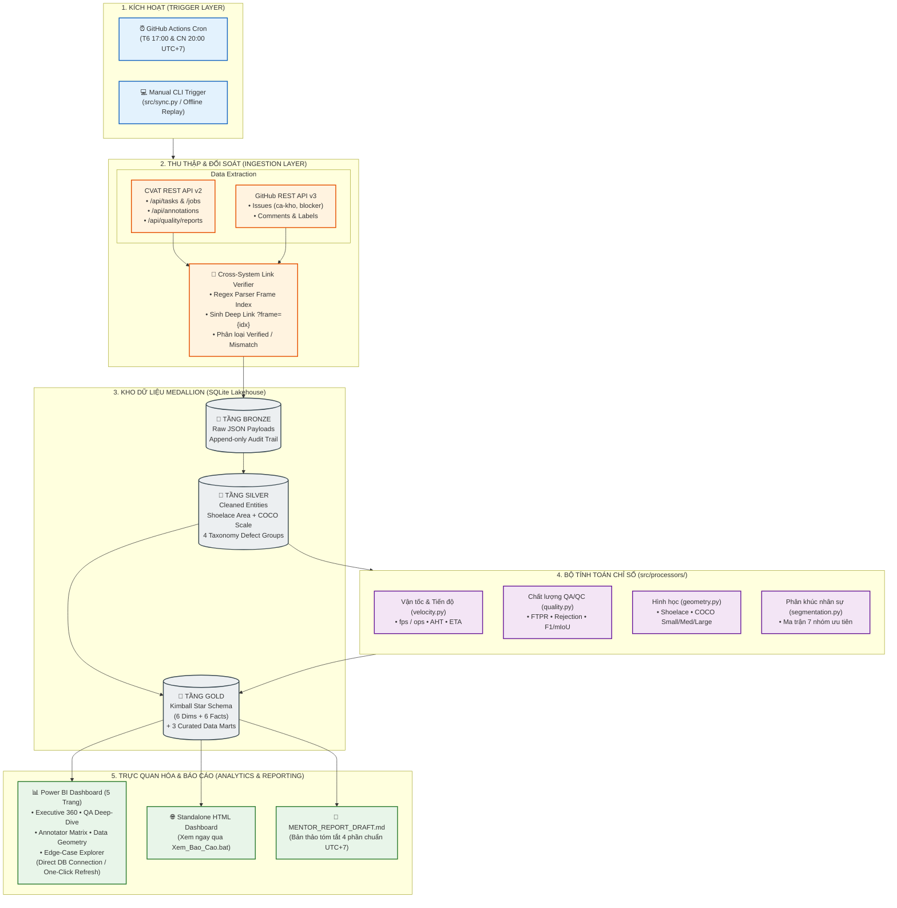
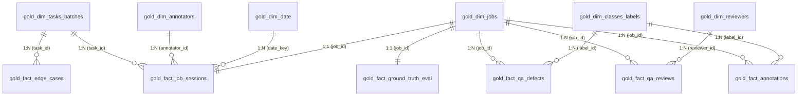
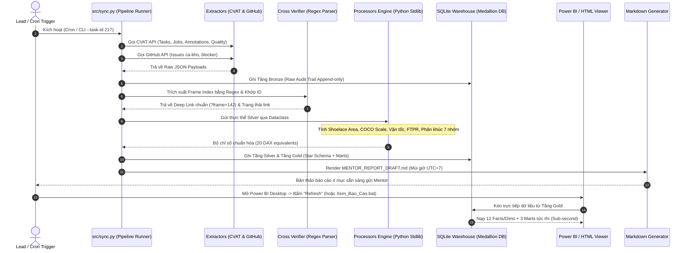

# 🚀 auto-annotation-reporter

> **Đường chạy Desktop hiện tại:** bấm [START_AUTO.cmd](START_AUTO.cmd). Bộ khởi động tự tạo môi trường Python, cài thư viện cố định, chạy pipeline và publish PostgreSQL cho Power BI DirectQuery. Cần cài sẵn Python 3.10+, Docker và Power BI; đăng nhập nguồn một lần trên mỗi máy. Mặc định demo, không cần CVAT_TOKEN; hỗ trợ chọn snapshot hoặc nguồn thật qua cấu hình riêng. Xem [hướng dẫn dùng trên nhiều máy](powerbi/MULTI_MACHINE_SETUP.md). Luồng demo đã được nghiệm thu trên máy Minh; chưa nghiệm thu máy sạch thứ hai hoặc CVAT thật. Kết quả mỗi lần chạy: `data/runs/latest.json`. Bản Import và nội dung prototype phía dưới được giữ để tham khảo lịch sử.

### 📊 Hệ Thống Tự Động Hóa Quản Trị & Báo Cáo Gán Nhãn Dữ Liệu AI (CVAT & GitHub Sync)
#### *Mô Hình Hybrid: Python ETL Engine + Kho Dữ Liệu Medallion (SQLite) + Power BI 5-Page Dashboard*

[](https://www.python.org/)
[](https://www.cvat.ai/)
[](https://docs.github.com/en/rest)
[-003B57?logo=sqlite)](src/storage/db_manager.py)
[](powerbi/POWERBI_REPORT_GUIDE.md)
[-success?logo=pytest)](tests/)
[](workflows/scheduled_report.yml)

> **Hệ sinh thái toàn diện tự động hóa thu thập, kiểm toán, tính toán chỉ số KPI và trực quan hóa tiến độ & chất lượng gán nhãn dữ liệu Computer Vision từ CVAT và GitHub. Ứng dụng chuẩn kiến trúc kho dữ liệu Medallion (Bronze $\to$ Silver $\to$ Gold), cung cấp kết nối trực tiếp vào Power BI Desktop (One-Click Refresh) cùng báo cáo tóm tắt tự động trước mỗi phiên họp Mentor & Leader.**

---

## 📑 Mục Lục
1. [Bối cảnh & Vấn đề giải quyết](#-1-bối-cảnh--vấn-đề-giải-quyết)
2. [Sơ đồ Kiến trúc & Luồng Dữ liệu Hiện tại](#-2-sơ-đồ-kiến-trúc--luồng-dữ-liệu-hiện-tại)
   - [2.1. Sơ đồ Kiến trúc Tổng thể Hệ thống (End-to-End Pipeline)](#21-sơ-đồ-kiến-trúc-tổng-thể-hệ-thống-end-to-end-pipeline)
   - [2.2. Sơ đồ Kho Dữ Liệu Chuẩn Medallion (Bronze - Silver - Gold)](#22-sơ-đồ-kho-dữ-liệu-chuẩn-medallion-bronze---silver---gold)
   - [2.3. Sơ đồ Mô hình Dữ liệu Hình Sao (Star Schema ERD)](#23-sơ-đồ-mô-hình-dữ-liệu-hình-sao-star-schema-erd)
   - [2.4. Sơ đồ Luồng Thực Thi Tự Động Hóa (Sequence Execution Flow)](#24-sơ-đồ-luồng-thực-thi-tự-động-hóa-sequence-execution-flow)
3. [Các Phân Hệ Cốt Lõi Đã Xây Dựng](#-3-các-phân-hệ-cốt-lõi-đã-xây-dựng)
   - [3.1. Phân hệ Ingestion & Cross-System Link Verification](#31-phân-hệ-ingestion--cross-system-link-verification)
   - [3.2. Phân hệ Động cơ Xử lý & Thuật toán Chỉ số (100% Python Stdlib)](#32-phân-hệ-động-cơ-xử-lý--thuật-toán-chỉ-số-100-python-stdlib)
   - [3.3. Phân hệ Kho Dữ Liệu Medallion Vật Lý (SQLite Data Warehouse)](#33-phân-hệ-kho-dữ-liệu-medallion-vật-lý-sqlite-data-warehouse)
   - [3.4. Phân hệ Power BI Analytics Dashboard & Standalone Viewer](#34-phân-hệ-power-bi-analytics-dashboard--standalone-viewer)
   - [3.5. Phân hệ Báo Cáo Tóm Tắt (Mentor Report Generator)](#35-phân-hệ-báo-cáo-tóm-tắt-mentor-report-generator)
4. [Cấu Trúc Thư Mục Dự Án Hiện Tại](#-4-cấu-trúc-thư-mục-dự-án-hiện-tại)
5. [Hướng Dẫn Cài Đặt & Vận Hành](#-5-hướng-dẫn-cài-đặt--vận-hành)
   - [5.1. Khởi tạo môi trường ảo](#51-khởi-tạo-môi-trường-ảo)
   - [5.2. Chạy Kiểm Thử Toàn Diện (67/67 Unit Tests)](#52-chạy-kiểm-thử-toàn-diện-6767-unit-tests)
   - [5.3. Chạy Pipeline Thu Thập & Sinh Báo Cáo (Online & Offline)](#53-chạy-pipeline-thu-thập--sinh-báo-cáo-online--offline)
   - [5.4. Nạp & Xác Minh Kho Dữ Liệu Medallion](#54-nạp--xác-minh-kho-dữ-liệu-medallion)
   - [5.5. Trực Quan Hóa Báo Cáo (Power BI & 1-Click HTML Viewer)](#55-trực-quan-hóa-báo-cáo-power-bi--1-click-html-viewer)
6. [Ma Trận Khớp Nối 20 Measures DAX & Python](#-6-ma-trận-khớp-nối-20-measures-dax--python)
7. [Bản Đồ Tài Liệu & Hồ Sơ Báo Cáo (Documentation Hub)](#-7-bản-đồ-tài-liệu--hồ-sơ-báo-cáo-documentation-hub)
8. [Nhóm Thực Hiện](#-8-nhóm-thực-hiện)

---

## 📌 1. Bối cảnh & Vấn đề giải quyết

Trong các dự án thị giác máy tính (Computer Vision) quy mô lớn, hoạt động quản trị dán nhãn dữ liệu (Data Annotation Operations) thường xuyên đối mặt với 4 điểm nghẽn nghiêm trọng:
1. **Phân mảnh dữ liệu**: Tiến độ và file annotation nằm trên nền tảng **CVAT**, trong khi thảo luận kỹ thuật, ca khó (`ca-kho`), lỗi chặn (`blocker`) và phân chia công việc lại nằm trên **GitHub Issues/PRs**.
2. **Tốn thời gian tổng hợp thủ công**: Trước mỗi buổi họp với Leader hoặc Mentor, nhóm trưởng thường mất **2 đến 4 giờ** để tải CSV, đếm số frame hoàn thành, tính vận tốc trung bình và gom câu hỏi.
3. **Mất dấu ca khó (Blind Spots)**: Các frame gán nhãn gây tranh chấp hoặc gắn cờ lỗi thường bị trôi trên CVAT nếu không được liên kết trực tiếp bằng **Deep Link** vào đúng khung hình (`?frame={idx}`).
4. **Thiếu kho kiểm toán (Audit Trail) & Kết nối BI chắp vá**: Việc chỉ xuất các file CSV rời rạc khiến việc theo dõi lịch sử nhiều đợt chạy (multi-batch) bị phân tán, không có bằng chứng đối soát khi có khiếu nại sai lệch số liệu.

👉 **Giải pháp của dự án**: Thiết lập một **Pipeline tự động hóa hoàn chỉnh theo chuẩn Enterprise Data Lakehouse**:
- Thu thập dữ liệu API từ cả CVAT và GitHub có cơ chế retry và chống SSRF.
- Tự động bóc tách chỉ số, tính diện tích hình học Shoelace, phân loại COCO scale và phân khúc 7 nhóm nhân sự.
- Lưu trữ 100% dữ liệu kiểm toán vào **Kho Dữ Liệu Medallion 3 Lớp (Bronze $\to$ Silver $\to$ Gold)** trên SQLite.
- Kết nối trực tiếp vào **Power BI Dashboard 5 trang** (One-Click Refresh) và tự động sinh bản thảo **Markdown Report** gửi Mentor trước 24 giờ.

---

## 🏗️ 2. Sơ đồ Kiến trúc & Luồng Dữ liệu Hiện tại

### 2.1. Sơ đồ Kiến trúc Tổng thể Hệ thống (End-to-End Pipeline)

Hệ thống hoạt động theo quy trình 5 giai đoạn liên hoàn, khép kín từ lúc kích hoạt đến khi hiển thị trước Mentor:



---

### 2.2. Sơ đồ Kho Dữ Liệu Chuẩn Medallion (Bronze - Silver - Gold)

Kho dữ liệu vật lý được tổ chức tại [`data/annotation_warehouse.db`](src/storage/db_manager.py) với 3 tầng phân định nghiêm ngặt:

```mermaid
flowchart LR
    subgraph BRONZE_ZONE["🥉 TẦNG BRONZE (RAW LAYER)"]
        direction TB
        B1["bronze_snapshots\n(Metadata đợt chạy, status)"]
        B2["bronze_cvat_raw\n(Payload JSON CVAT nguyên bản)"]
        B3["bronze_github_raw\n(Payload JSON GitHub nguyên bản)"]
        B4["bronze_team_reports_raw\n(Văn bản phản ánh các tổ)"]
        B_NOTE["Đặc tính: Append-only\nKhông sửa xóa, lưu vết 100%"]
    end

    subgraph SILVER_ZONE["🥈 TẦNG SILVER (CLEANSED & ENRICHED)"]
        direction TB
        S1["silver_jobs\n(Lọc status, tính active_time_hours)"]
        S2["silver_annotations\n(Shoelace diện tích, COCO Scale)"]
        S3["silver_qa_reviews\n(Lượt kiểm định, iteration 1/2)"]
        S4["silver_qa_defects\n(4 nhóm Taxonomy chuẩn hóa)"]
        S5["silver_github_issues\n(Regex bóc tách frame_idx, Deep Link)"]
        S_NOTE["Đặc tính: Mức thực thể chi tiết\nKhử trùng lặp, xử lý NULL vs 0"]
    end

    subgraph GOLD_ZONE["🥇 TẦNG GOLD (CURATED / BUSINESS-READY)"]
        direction TB
        subgraph STAR["Kimball Star Schema"]
            DIMS["Bảng Chiều (Dimensions):\n• dim_annotators • dim_reviewers\n• dim_tasks_batches • dim_classes_labels\n• dim_date • dim_jobs"]
            FACTS["Bảng Sự Kiện (Facts):\n• fact_job_sessions • fact_annotations\n• fact_qa_reviews • fact_qa_defects\n• fact_ground_truth_eval • fact_edge_cases"]
        end
        subgraph MARTS["Data Marts Tổng Hợp"]
            M1["gold_mart_batch_progress\n(Tiến độ %, Vận tốc, ETA)"]
            M2["gold_mart_qa_metrics\n(FTPR, Rejection, Điểm QA)"]
            M3["gold_mart_annotator_segments\n(7 Nhóm Phân Khúc Nhân Sự)"]
        end
    end

    BRONZE_ZONE -->|ETL Cleansing & Enrichment| SILVER_ZONE
    SILVER_ZONE -->|Star Modeling & Aggregation| GOLD_ZONE

    classDef bZone fill:#FFE0B2,stroke:#FB8C00,stroke-width:2px;
    classDef sZone fill:#CFD8DC,stroke:#546E7A,stroke-width:2px;
    classDef gZone fill:#FFF9C4,stroke:#FBC02D,stroke-width:2px;

    class BRONZE_ZONE bZone;
    class SILVER_ZONE sZone;
    class GOLD_ZONE gZone;
```



---

### 2.3. Sơ đồ Mô hình Dữ liệu Hình Sao (Star Schema ERD)

Cấu trúc quan hệ bảng tầng Gold kết nối tối ưu cho công nghệ nén VertiPaq của Power BI:



---

### 2.4. Sơ đồ Luồng Thực Thi Tự Động Hóa (Sequence Execution Flow)

Chuỗi tương tác từ khi kích hoạt đến khi cung cấp báo cáo:



---

## ⚡ 3. Các Phân Hệ Cốt Lõi Đã Xây Dựng

### 3.1. Phân hệ Ingestion & Cross-System Link Verification
* **Lớp nền tảng [`src/extractors/base_client.py`](src/extractors/base_client.py)**: Quản lý kết nối HTTP qua `requests.Session` tích hợp retry tự động với backoff factor (`urllib3.util.retry.Retry`), chặn triệt để tấn công SSRF / Open Redirect và loại bỏ Token nhạy cảm khỏi log.
* **Bộ trích xuất CVAT [`src/extractors/cvat_extractor.py`](src/extractors/cvat_extractor.py)**: Bóc tách danh mục Task, Job, phân công (`assignee`), trạng thái hoàn thành và tóm tắt annotations (shapes, tracks, tags).
* **Bộ trích xuất GitHub [`src/extractors/github_extractor.py`](src/extractors/github_extractor.py)**: Quét issues, labels (`ca-kho`, `blocker`), comments.
* **Bộ phân giải Frame & Deep Link**: Parser Regex thông minh nhận diện linh hoạt các cú pháp: `Frame index: 142`, `Khung hình: 142`, tự động tạo URL trỏ thẳng tới khung hình lỗi trên CVAT:
  $$\text{URL} = \text{https://<cvat-host>/tasks/}\{\text{task\_id}\}\text{/jobs/}\{\text{job\_id}\}\text{?frame=}\{\text{frame\_idx}\}$$

### 3.2. Phân hệ Động cơ Xử lý & Thuật toán Chỉ số (100% Python Stdlib)
Tuân thủ nguyên tắc **100% Python Standard Library (không cài thư viện ngoài)**, tất định và chuẩn hóa tuyệt đối:
* **Vận tốc & Tiến độ ([`src/processors/velocity.py`](src/processors/velocity.py))**:
  - Tính toán $Velocity_{fps}$ và $Velocity_{ops}$, AHT (Average Handling Time).
  - Thuật toán `active_seconds_from_events`: Lọc thời gian nhàn rỗi (idle time) với ngưỡng 300 giây.
  - Dự báo ngày hoàn thành (ETA) dựa trên cửa sổ vận tốc 7 ngày gần nhất.
* **Chất lượng QA/QC ([`src/processors/quality.py`](src/processors/quality.py))**:
  - Tính **FTPR (First Time Pass Rate)** chuẩn xác chỉ trên `review_iteration = 1`.
  - Chuẩn hóa lỗi về **4 nhóm Taxonomy quốc tế**: `box_displacement`, `wrong_class`, `missing_object`, `wrong_attr`.
  - Tính điểm AI Benchmark: mean IoU ($mIoU$) và $F_1\text{-Score}$.
* **Hình học đối tượng ([`src/processors/geometry.py`](src/processors/geometry.py))**:
  - Thuật toán Shoelace (Gauss) tính diện tích đa giác và bounding box.
  - Phân loại kích cỡ theo chuẩn **COCO Scale**:
    - **Small**: $\text{Diện tích} < 1024\text{ px}^2$
    - **Medium**: $1024 \le \text{Diện tích} \le 9216\text{ px}^2$
    - **Large**: $\text{Diện tích} > 9216\text{ px}^2$
* **Ma trận phân khúc 7 nhóm nhân sự ([`src/processors/segmentation.py`](src/processors/segmentation.py))**:
  - Phân nhóm theo thứ tự ưu tiên nghiêm ngặt từ 1 đến 7:
    1. `FAST_AND_FAULTY` (Nguy cơ ẩu: Siêu nhanh + Rủi ro chất lượng cao)
    2. `NEEDS_RETRAINING` (Cần đào tạo lại: Chậm + Rủi ro chất lượng cao)
    3. `SLOW_BUT_STEADY` (Cẩn trọng: Chậm + Chất lượng đạt chuẩn)
    4. `STAR_ANNOTATOR` (Ngôi sao nòng cốt: Vận tốc đạt/vượt chuẩn + Chất lượng cao)
    5. `ONBOARDING` (Nhân sự mới: Thâm niên $\le 14$ ngày, $\le 10$ jobs)
    6. `INACTIVE` (Ngừng hoạt động: 0 giờ làm việc trong 7 ngày)
    7. `CORE_PERFORMER` (Nhân sự nền tảng ổn định)

### 3.3. Phân hệ Kho Dữ Liệu Medallion Vật Lý (SQLite Data Warehouse)
Lưu trữ tập trung tại [`data/annotation_warehouse.db`](src/storage/db_manager.py):
* **Bronze**: Lưu nguyên văn payload JSON API của CVAT, GitHub và biên bản họp phục vụ kiểm toán 100%.
* **Silver**: Các bảng thực thể hạt chi tiết (`silver_jobs`, `silver_annotations`, `silver_qa_defects`...).
* **Gold**:
  - **Star Schema**: 6 bảng Dim + 6 bảng Fact.
  - **3 Data Marts**: `gold_mart_batch_progress` (Tiến độ), `gold_mart_qa_metrics` (Chất lượng), `gold_mart_annotator_segments` (Nhân sự).
  - Tích hợp công cụ nạp tự động [`src/storage/populate_warehouse.py`](src/storage/populate_warehouse.py) và kiểm toán trạng thái [`src/storage/verify_warehouse.py`](src/storage/verify_warehouse.py).

### 3.4. Phân hệ Power BI Analytics Dashboard & Standalone Viewer
* **Báo cáo 5 trang chuyên nghiệp** ([`powerbi/Dashboard.pbix`](powerbi/Dashboard.pbix) & [`powerbi/Dashboard_Configured.pbix`](powerbi/Dashboard_Configured.pbix)):
  1. **Executive 360**: KPI tiến độ, % hoàn thành batch, vận tốc toàn đội, biểu đồ burndown.
  2. **QA & Quality Deep-Dive**: Ma trận 4 nhóm lỗi, defect density trên 100 frames, điểm mIoU/F1.
  3. **Annotator Matrix**: Biểu đồ phân tán (Scatter plot) Vận tốc vs FTPR, phân khúc 7 nhóm nhân sự.
  4. **Data Geometry**: Phân bố nhãn lớp, tỷ lệ vật thể COCO Small/Medium/Large, tỷ lệ chiếm dụng frame.
  5. **Edge-Case Explorer**: Bảng ca khó với URL Deep Link mở trực tiếp frame CVAT tương ứng.
* **Kết nối trực tiếp Database**: Script [`powerbi/powerbi_direct_db_connector.py`](powerbi/powerbi_direct_db_connector.py) cho phép Power BI kéo thẳng dữ liệu từ SQLite, cập nhật số liệu chỉ với 1 nút bấm (**One-Click Refresh**).
* **Báo cáo tương tác độc lập (Zero-Install)**: File [`powerbi/Dashboard.html`](powerbi/Dashboard.html) cho phép mở duyệt toàn bộ 5 trang biểu đồ trực quan ngay trên trình duyệt web qua [`Xem_Bao_Cao.bat`](Xem_Bao_Cao.bat).

### 3.5. Phân hệ Báo Cáo Tóm Tắt (Mentor Report Generator)
* Động cơ [`src/generators/markdown_generator.py`](src/generators/markdown_generator.py) tự động tổng hợp số liệu thành tài liệu Markdown [`reports/MENTOR_REPORT_DRAFT.md`](reports/MENTOR_REPORT_DRAFT.md) theo chuẩn 4 phần:
  1. *Tổng quan tiến độ & KPI vận tốc*.
  2. *Chỉ số chất lượng QA/QC & Điểm Benchmark AI*.
  3. *Bảng danh sách Ca khó kèm Deep Link mở thẳng Frame CVAT*.
  4. *Danh sách câu hỏi mở & Vấn đề cần Mentor hỗ trợ gỡ rối*.

---

## 📁 4. Cấu Trúc Thư Mục Dự Án Hiện Tại

```text
auto-annotation-reporter/
├── .github/
│   ├── ISSUE_TEMPLATE/                  # Mẫu tạo GitHub Issue chuẩn hóa
│   │   ├── edge-case.yml                # Template báo cáo ca khó kèm Frame Index
│   │   └── mentor-question.yml          # Template gửi câu hỏi định hướng Mentor
│   └── workflows/                       # Luồng CI/CD & Automation
├── assets/                              # Sơ đồ kiến trúc vector SVG
├── data/
│   ├── annotation_warehouse.db          # CƠ SỞ DỮ LIỆU KHO MEDALLION VẬT LÝ (SQLite)
│   ├── raw/                             # Dữ liệu thô phân tầng theo timestamp
│   └── processed/                       # Dữ liệu xuất bản CSV chuẩn hóa UTF-8 BOM
├── docs/                                # Thư viện tài liệu kỹ thuật chuẩn mực
│   ├── 01-architecture/                 # Đặc tả kiến trúc hệ thống, Hybrid & Workflows
│   ├── 02-data-and-analytics/           # Data Dictionary, Data Contract, 20 DAX Measures
│   ├── 03-integrations/                 # Hướng dẫn kết nối CVAT REST API & GitHub API
│   ├── 04-devops-automation/            # Hướng dẫn cấu hình Cron Workflow & Secrets
│   └── 05-project-management/           # Kế hoạch WBS, RACI và nghiệm thu
├── powerbi/                             # Phân hệ Dashboard & Trực quan hóa
│   ├── Dashboard.pbix                   # File thiết kế Power BI gốc
│   ├── Dashboard_Configured.pbix        # File Power BI đã cấu hình 5 trang chuẩn
│   ├── Dashboard.html                   # Interactive Dashboard chạy trên nền Web
│   ├── dax_measures.dax                 # 20 công thức DAX Measures chuẩn
│   ├── power_query_scripts.m            # Script Power Query M nạp 12 bảng
│   ├── powerbi_direct_db_connector.py   # Script kết nối trực tiếp SQLite vào Power BI
│   ├── generate_powerbi_data.py         # Script tạo bộ dữ liệu mẫu chuẩn hóa cho BI
│   ├── POWERBI_REPORT_GUIDE.md          # Hướng dẫn chi tiết vận hành Power BI
│   └── data/                            # 12 bảng Dimension & Fact định dạng CSV UTF-8 BOM
├── reports/                             # Hồ sơ nghiệm thu & Báo cáo tiến độ
│   ├── BAO_CAO_HOP_NHAT_MEDALLION_VA_KET_NOI_POWERBI.md  # Biên bản kiến trúc Medallion
│   ├── NGHIEM_THU_VA_TICH_HOP_API_INGESTION.md           # Biên bản nghiệm thu Ingestion
│   ├── BAO_CAO_CONG_VIEC_PHAM_NGUYEN_TUAN.md             # Báo cáo kỹ thuật ETL Processors
│   ├── MENTOR_REPORT_DRAFT.md           # Bản thảo báo cáo tóm tắt tự động
│   └── weekly/                          # Báo cáo sprint hàng tuần
├── sample_data/                         # Dữ liệu snapshot mẫu kiểm thử
│   ├── cvat.json / github.json          # Dữ liệu giả lập ca khó và phân công
│   └── real_snapshot/                   # Dữ liệu snapshot thực tế từ CVAT Task 217
├── src/                                 # MÃ NGUỒN CHÍNH CỦA HỆ THỐNG
│   ├── sync.py                          # CLI điều phối toàn trình pipeline
│   ├── adapters/                        # Chuyển đổi JSON snapshot sang Dataclass
│   ├── extractors/                      # BaseClient, CVATExtractor, GitHubExtractor
│   ├── processors/                      # Velocity, Quality, Geometry, Segmentation
│   ├── storage/                         # Medallion DB Manager, Populate & Verify Scripts
│   ├── exporters/                       # Tầng xuất bản dữ liệu sạch CSV UTF-8 BOM
│   └── generators/                      # Render Markdown Báo cáo Mentor (UTC+7)
├── tests/                               # BỘ KIỂM THỬ TỰ ĐỘNG (67/67 PASS 100%)
│   ├── adapters/                        # Kiểm thử chuyển đổi dữ liệu
│   ├── processors/                      # Kiểm thử thuật toán chỉ số & phân khúc
│   ├── exporters/                       # Kiểm thử schema bảng CSV xuất bản
│   └── test_*.py                        # Kiểm thử API clients, DB Manager, Generators
├── workflows/
│   └── scheduled_report.yml             # Workflow GitHub Actions chạy định kỳ
├── .env.example                         # Cấu hình biến môi trường mẫu
├── requirements.txt                     # Danh mục thư viện phụ thuộc Python
├── Xem_Bao_Cao.bat                      # Phím tắt mở nhanh Dashboard HTML trên Windows
└── README.md                            # Hướng dẫn tổng quan dự án
```

---

## 🚀 5. Hướng Dẫn Cài Đặt & Vận Hành

### 5.1. Khởi tạo môi trường ảo

Yêu cầu: **Python 3.10 trở lên** trên Windows, Linux hoặc macOS.

```bash
# 1. Clone repository
git clone https://github.com/nolanminhdinh/auto-annotation-reporter.git
cd auto-annotation-reporter

# 2. Tạo môi trường ảo
python -m venv .venv

# 3. Kích hoạt môi trường:
# Trên Windows PowerShell:
.\.venv\Scripts\Activate.ps1
# Trên Linux / macOS:
# source .venv/bin/activate

# 4. Cài đặt các thư viện cần thiết
pip install -r requirements.txt
```

---

### 5.2. Chạy Kiểm Thử Toàn Diện (67/67 Unit Tests)

Chạy bộ test suite tự động với `pytest`:

```powershell
.\.venv\Scripts\python.exe -m pytest tests/ -v
```

Hoặc sử dụng `unittest` tích hợp sẵn của Python:

```bash
python -m unittest discover -s tests -v
```

> **Kết quả kiểm thử**: Toàn bộ **67/67 unit test cases** vượt qua với tỉ lệ thành công **100%** trong thời gian chưa đầy **0.7 giây**.

---

### 5.3. Chạy Pipeline Thu Thập & Sinh Báo Cáo (Online & Offline)

Tạo file `.env` từ file mẫu:
```bash
cp .env.example .env
```
Cấu hình các tham số: `CVAT_HOST`, `CVAT_TOKEN`, `CVAT_TASK_ID`, `GITHUB_TOKEN`, `GITHUB_REPO`.

#### Cách 1: Chạy Thử Nghiệm Offline (Replay Snapshot Mẫu)
Chạy kiểm thử tức thì toàn bộ chu trình xử lý mà không cần kết nối mạng:
```bash
python src/sync.py --offline sample_data/ --session "Phiên Mentor Thử Nghiệm"
```
*Hệ thống sẽ bóc tách snapshot, tính toán chỉ số, sinh file `report_data.json` và bản thảo báo cáo `reports/MENTOR_REPORT_DRAFT.md`.*

#### Cách 2: Chạy Trực Tiếp Qua API (Online Mode)
```bash
python src/sync.py --task-id 217 --repo your_org/your_repo --session "Báo Cáo Sprint Tuần 2"
```

---

### 5.4. Nạp & Xác Minh Kho Dữ Liệu Medallion

Khởi tạo và nạp toàn bộ dữ liệu 3 tầng (Bronze $\to$ Silver $\to$ Gold) vào file Database SQLite:

```bash
# Nạp dữ liệu vào Database data/annotation_warehouse.db
python src/storage/populate_warehouse.py

# Kiểm tra tình trạng các bảng và số lượng bản ghi
python src/storage/verify_warehouse.py
```

Bảng kiểm kê trạng thái kho dữ liệu sau khi nạp:
| Tầng | Tên Bảng | Số Bản Ghi | Mục đích nghiệp vụ |
|---|---|:---:|---|
| **Bronze** | `bronze_snapshots` / `bronze_cvat_raw` / `bronze_github_raw` | **4** | Lưu vết nguyên văn API payloads phục vụ kiểm toán |
| **Silver** | `silver_jobs`, `silver_annotations`, `silver_qa_reviews`, `silver_qa_defects`, `silver_github_issues` | **39** | Thực thể chi tiết đã làm sạch, tính Shoelace & COCO Scale |
| **Gold** | `gold_dim_*` (6 bảng chiều) + `gold_fact_*` (6 bảng sự kiện) | **85** | Mô hình Star Schema chuẩn phục vụ Power BI |
| **Gold** | `gold_mart_batch_progress`, `gold_mart_qa_metrics`, `gold_mart_annotator_segments` | **5** | Data Marts tổng hợp sẵn KPI điều hành |

---

### 5.5. Trực Quan Hóa Báo Cáo (Power BI & 1-Click HTML Viewer)

#### Cách 1: Xem Ngay Trên Trình Duyệt Web (Không Cần Cài Đặt)
Click đúp chuột vào file:
```cmd
Xem_Bao_Cao.bat
```
Hoặc mở trực tiếp file [`powerbi/Dashboard.html`](powerbi/Dashboard.html). Giao diện web tương tác hiển thị đầy đủ 5 trang báo cáo điều hành với biểu đồ Chart.js động.

#### Cách 2: Kết Nối Trực Tiếp Database Trong Power BI Desktop
1. Mở file [`powerbi/Dashboard_Configured.pbix`](powerbi/Dashboard_Configured.pbix) trong Power BI Desktop.
2. Bấm **Get Data** $\to$ **Python Script**.
3. Dán nội dung từ [`powerbi/powerbi_direct_db_connector.py`](powerbi/powerbi_direct_db_connector.py).
4. Bấm **Load**. Toàn bộ 15 bảng sẽ nạp thẳng từ SQLite.
5. Mỗi khi có đợt chạy mới, chỉ cần bấm **Refresh** trên thanh công cụ Power BI!

#### Cách 3: Nạp Qua File CSV Chuẩn Hóa UTF-8 BOM
Toàn bộ 12 file CSV đã được chuẩn hóa tại [`powerbi/data/`](powerbi/data/). Mở Power Query và dán các đoạn mã M tương ứng trong [`powerbi/power_query_scripts.m`](powerbi/power_query_scripts.m).

---

## 🧮 6. Ma Trận Khớp Nối 20 Measures DAX & Python

Toàn bộ 20 Measures DAX đã được lập trình đối ứng trong tầng [`src/processors/`](src/processors/) đảm bảo **kết quả khớp nhau 100%**:

| STT | Tên Measure DAX | Nhóm Nghiệp Vụ | Hàm Python Đối Ứng (`src/processors/`) | Đơn Vị & Format |
|:---:|---|---|---|:---:|
| 1 | `Total_Completed_Frames` | Tiến độ | `velocity.total_completed_frames` | `#,#0` |
| 2 | `Total_Objects_Created` | Tiến độ | `velocity.total_objects_created` | `#,#0` |
| 3 | `Total_Active_Hours` | Năng suất | `velocity.total_active_hours` | `0.00` giờ |
| 4 | `Velocity_Frames_Per_Hour`| Năng suất | `velocity.velocity_frames_per_hour` | `0.0` f/h |
| 5 | `Velocity_Objects_Per_Hour`| Năng suất | `velocity.velocity_objects_per_hour` | `0.0` obj/h |
| 6 | `Avg_Time_Per_Frame_Mins` | Hiệu suất | `velocity.avg_time_per_frame_minutes`| `0.0` phút |
| 7 | `Avg_Time_Per_Object_Secs`| Hiệu suất | `velocity.avg_time_per_object_seconds`| `0.0` giây |
| 8 | `First_Time_Pass_Rate` | Chất lượng QA | `quality.first_time_pass_rate` | `0.0%` |
| 9 | `Rejection_Rate` | Chất lượng QA | `quality.rejection_rate` | `0.0%` |
| 10| `Total_Defects` | Chất lượng QA | `quality.total_defects` | `#,#0` |
| 11| `Defect_Density_Per_100F` | Chất lượng QA | `quality.defect_density_per_100_frames`| `0.00` |
| 12| `Avg_Defects_Per_Job` | Chất lượng QA | `quality.avg_defects_per_job` | `0.0` |
| 13| `Avg_mIoU_Score` | AI Benchmark | `quality.avg_miou` | `0.000` |
| 14| `Avg_F1_Score` | AI Benchmark | `quality.avg_f1` | `0.000` |
| 15| `Avg_Object_Area_Pixels` | Hình học | `geometry.avg_object_area` | `#,##0` px² |
| 16| `Avg_Area_Frame_Pct` | Hình học | `geometry.avg_area_frame_pct` | `0.00%` |
| 17| `Pct_Small_Objects` | Hình học | `geometry.pct_small_objects` | `0.0%` |
| 18| `Count_At_Risk_Annotators`| Quản trị rủi ro | `segmentation.classify_quality_risk` | `#,#0` người |
| 19| `System_Avg_Velocity` | Benchmark | `velocity.system_avg_velocity` | `0.0` f/h |
| 20| `Project_Progress_Pct` | Tiến độ tổng thể | `velocity.progress_ratio` | `0.0%` |

---

## 📚 7. Bản Đồ Tài Liệu & Hồ Sơ Báo Cáo (Documentation Hub)

Hệ thống tài liệu dự án được cấu trúc bài bản theo 5 nhóm chuyên trách và khu vực báo cáo định kỳ:

* 🏛️ **Nhóm 1: Kiến Trúc & Thiết Kế Hệ Thống** ([`docs/01-architecture/`](docs/01-architecture/))
  - [`SYSTEM_ARCHITECTURE.md`](docs/01-architecture/SYSTEM_ARCHITECTURE.md): Đặc tả kiến trúc khép kín 5 giai đoạn.
  - [`HYBRID_POWERBI_ARCHITECTURE.md`](docs/01-architecture/HYBRID_POWERBI_ARCHITECTURE.md): Chi tiết mô hình lai Python ETL & Power BI.
  - [`WORKFLOWS.md`](docs/01-architecture/WORKFLOWS.md): Tổng hợp các sơ đồ luồng hoạt động chi tiết.
* 📊 **Nhóm 2: Nghiệp Vụ & Dữ Liệu Báo Cáo** ([`docs/02-data-and-analytics/`](docs/02-data-and-analytics/))
  - [`PROJECT_ANALYTICS_SPEC.md`](docs/02-data-and-analytics/PROJECT_ANALYTICS_SPEC.md): Tài liệu đặc tả cốt lõi (Data Dictionary, Star Schema, 20 DAX Measures, Thuật toán phân khúc nhân sự).
  - [`REPORT_TEMPLATE_SPEC.md`](docs/02-data-and-analytics/REPORT_TEMPLATE_SPEC.md): Chuẩn cấu trúc văn bản báo cáo 4 phần gửi Mentor.
  - [`MENTOR_REPORT_SAMPLE.md`](docs/02-data-and-analytics/MENTOR_REPORT_SAMPLE.md): Báo cáo mẫu minh họa thực tế.
* 🔌 **Nhóm 3: Tích Hợp API & Thu Thập Dữ Liệu** ([`docs/03-integrations/`](docs/03-integrations/))
  - [`CVAT_INTEGRATION_GUIDE.md`](docs/03-integrations/CVAT_INTEGRATION_GUIDE.md): Kết nối REST API v2 và sinh URL Deep Link.
  - [`GITHUB_INTEGRATION_GUIDE.md`](docs/03-integrations/GITHUB_INTEGRATION_GUIDE.md): Trích xuất issues ca khó, blocker và tự động mở PR.
* ⚙️ **Nhóm 4: DevOps, Tự Động Hóa & Vận Hành** ([`docs/04-devops-automation/`](docs/04-devops-automation/))
  - [`SCHEDULED_WORKFLOW_GUIDE.md`](docs/04-devops-automation/SCHEDULED_WORKFLOW_GUIDE.md): Hướng dẫn cấu hình GitHub Actions Cron Trigger.
  - [`DEPLOYMENT_AND_WORKFLOW.md`](docs/04-devops-automation/DEPLOYMENT_AND_WORKFLOW.md): Triển khai hạ tầng và webhook bot.
* 👥 **Nhóm 5: Quản Trị Dự Án & Kế Hoạch Thực Hiện** ([`docs/05-project-management/`](docs/05-project-management/))
  - [`PROJECT_MANAGEMENT_PLAN.md`](docs/05-project-management/PROJECT_MANAGEMENT_PLAN.md): Cơ cấu nhóm, phân công WBS, ma trận RACI và tiêu chí nghiệm thu.
* 📑 **Hồ Sơ Biên Bản Nghiệm Thu & Tiến Độ Mới Nhất** ([`reports/`](reports/)):
  - [`BAO_CAO_HOP_NHAT_MEDALLION_VA_KET_NOI_POWERBI.md`](reports/BAO_CAO_HOP_NHAT_MEDALLION_VA_KET_NOI_POWERBI.md): Biên bản thống nhất chuẩn kho dữ liệu Medallion và kết nối Power BI trực tiếp.
  - [`NGHIEM_THU_VA_TICH_HOP_API_INGESTION.md`](reports/NGHIEM_THU_VA_TICH_HOP_API_INGESTION.md): Biên bản nghiệm thu module thu thập dữ liệu và phân giải Frame Deep Link.
  - [`BAO_CAO_CONG_VIEC_PHAM_NGUYEN_TUAN.md`](reports/BAO_CAO_CONG_VIEC_PHAM_NGUYEN_TUAN.md): Đánh giá hiệu quả kỹ thuật module ETL Processors.

---

## 👥 8. Nhóm Thực Hiện

* **Đinh Công Minh** ([@nolanminhdinh](https://github.com/nolanminhdinh)) — **Project Lead & BI Architect**
  * *Chủ trì kiến trúc giải pháp, thiết kế Data Model Star Schema, bộ 20 DAX Measures, xây dựng Dashboard Power BI và phụ trách nghiệm thu UAT.*
* **Nguyễn Minh Tú** — **Data Integration Engineer**
  * *Phụ trách tích hợp CVAT REST API v2, bóc tách cấu trúc Jobs, Tasks và Annotations.*
* **Vũ Trường Duy** — **Data Integration Engineer**
  * *Phụ trách tích hợp GitHub API, kiểm định liên kết chéo và cơ chế Snapshot Raw.*
* **Phạm Nguyễn Tuân** — **Analytics & ETL Engineer**
  * *Xây dựng động cơ tính toán chỉ số (WBS 2.1 – 2.5), thuật toán Shoelace, COCO Scale, phân khúc nhân sự và xuất bản dữ liệu.*
* **Ngô Duy Ngọc** — **DevOps & Automation Engineer**
  * *Phụ trách GitHub Actions CI/CD Pipeline, Scheduled Dispatcher và Notification Bot.*
