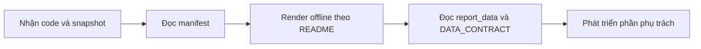

# Bàn giao integration v1 và việc tiếp theo

**Cập nhật:** 16/10/2026. Phần tích hợp đã đọc API thật, lưu snapshot, annotations
và bản nháp bốn mục. Bản main đã thêm đọc frame và metadata Quality Report; điểm QA chính thức chưa được kiểm chứng, chỉ số thời gian chưa triển khai.

## Bộ bàn giao

| Nhận gì | Dùng để làm gì |
|---|---|
| src/ (extractors/processors/generators), tests/, requirements.txt, .env.example | Chạy code và kiểm tra hành vi |
| [README](README.md) | Cài đặt, cấu hình, chọn task/repo |
| [DATA_CONTRACT](DATA_CONTRACT.md) | Hiểu output trước khi tính toán |
| Một snapshot đầy đủ | Test offline, đối chiếu và phát triển báo cáo |
| [tracker-templates](tracker-templates/README.md) | Mẫu ca khó/câu hỏi cho repo GitHub riêng |

Snapshot gồm manifest.json, cvat.json, github.json, links.json, report_data.json
và MENTOR_REPORT_DRAFT.md. Chọn lần lấy cả hai nguồn success, annotations không
lỗi và kiểm tra links. Dataset gửi riêng qua kênh chia sẻ của nhóm; main hiện chưa ignore data/raw/, cần tránh stage snapshot thật;
không gửi .env hoặc token. Giữ nguyên cấu trúc và tên file.

## Người nhận bắt đầu như thế nào?

Người làm báo cáo/BI dùng report_data.json; raw và links để đối chiếu. Không có
token hoặc quyền CVAT vẫn test render được với snapshot đã nhận. Test mock
kiểm tra logic, không chứng minh quyền hoặc schema của mọi task thật.

## Trạng thái theo nhu cầu sản phẩm

| Hạng mục | Hiện tại | Việc tiếp theo |
|---|---|---|
| Tiến độ batch | Trạng thái và tỷ lệ theo annotation jobs | Chốt batch nhiều task, hoàn thành frame |
| Điểm chấm | Thử đọc metadata Quality Report; value có thể null | Tải /data/conflicts, kiểm chứng report và chốt thang điểm |
| Ca khó/câu hỏi | GitHub labels, link job; đọc frame từ body | Xác minh phạm vi frame/object, taxonomy, dữ liệu thật |
| Thời gian làm/nộp job | Chưa có | Khảo sát events/analytics và định nghĩa nộp |
| Lịch sử review | Chưa có | Chốt lượt review/pass/reject và nguồn sự kiện |
| Ground Truth evaluation | Đọc danh sách reports, chưa kết quả đầy đủ | Kiểm tra GT, report/data/conflicts và quyền đọc |
| Vận hành | Chạy tay | Workflow lịch, Secrets, artifact và lỗi |
| Đánh giá đề tài | Timestamp chạy/tạo nháp | Nhật ký soạn/nộp để đo trước/sau và nộp sau 12:00 |

## Đầu việc theo vai trò

| Vai trò đề xuất | Đầu vào | Kết quả cần trả lại |
|---|---|---|
| QA/QC | JSON nguồn, annotations, trạng thái job | Định nghĩa review/nộp, nguồn điểm, trường thiếu và ví dụ |
| Xử lý/BI | report_data + contract | Mô hình bảng, CSV nếu cần, KPI đã thống nhất |
| Soạn báo cáo | JSON + Markdown | Bố cục, tóm tắt/đề xuất, giữ lý do thiếu dữ liệu |
| DevOps | src/sync.py | Lịch thứ 5/Chủ nhật, artifact, kiểm tra exit code |
| Nhóm trưởng | Bản nháp + metadata | Tên phiên, deadline, nơi nộp, review và cách đo thời gian |

Đây là đề xuất phối hợp, không thay thế phân công nhóm. Không cần đợi điểm QA
để làm bố cục, mô hình dữ liệu hoặc automation.

## Trường đề xuất bổ sung — chưa có trong output

| Nhóm | Tên trường đề xuất | Nguồn cần kiểm tra | Quyết định cần có |
|---|---|---|---|
| Giờ làm | job_id, user_id, working_time_ms, period_start/end, measurement_method | CVAT events/analytics | Quyền/gói tài khoản, cách tính thời gian hoạt động |
| Nộp job | submitted_at, actor_id, source_event_id | Sự kiện đổi stage/state | Trạng thái được coi là nộp, cách tính nộp lại |
| Review | review_id, reviewer_id, review_round, result, started_at/finished_at | Events + issues/comments hoặc nhật ký reviewer | Định nghĩa lượt review và kết quả |
| Ground Truth | report_id, gt_job_id, metrics, conflicts, evaluated_at, settings | Quality Reports/data/conflicts | GT hợp lệ, phạm vi, diễn giải metric |
| Ca khó | frame, annotation_id, annotation_kind, frame_url | CVAT Issue và quy ước GitHub | Frame, phạm vi và kiểm tra link |
| Soạn/nộp báo cáo | method, drafting_started_at/finished_at, submitted_at, deadline_at, evidence_url | Nhật ký quy trình nhóm | Cùng cách đo cho thủ công và có hỗ trợ tự động |

Các tên trên là đề xuất schema, không bảo đảm API có trường tương ứng. Giờ làm
từ hệ thống không mặc định bao phủ công việc ngoài CVAT. Lịch sử GitHub không
tự trở thành lịch sử QA. Không suy ra ngày nộp từ updated_date hoặc chính xác
giờ chuyển trạng thái chỉ bằng snapshots định kỳ.

Tham khảo để khảo sát: [Events API](https://docs.cvat.ai/docs/api_sdk/sdk/reference/apis/events-api/),
[Analytics](https://docs.cvat.ai/docs/qa-analytics/analytics/),
[Quality API](https://docs.cvat.ai/docs/api_sdk/sdk/reference/apis/quality-api/),
[GitHub timeline](https://docs.github.com/en/rest/issues/timeline).
Chưa kiểm chứng trực tiếp các nguồn bổ sung trên tài khoản nhóm.

## Cách gửi phản hồi và thống nhất tích hợp

- Bug: lệnh chạy, lỗi, phạm vi task/repo, manifest đã lọc thông tin nhạy cảm.
- Yêu cầu dữ liệu: tên trường, ý nghĩa, kiểu/đơn vị, nguồn dự kiến, ví dụ.
- Nghiệp vụ: ai nhập/chấm, khi nào, tiêu chí đạt và cách xử lý dữ liệu thiếu.

Ưu tiên chốt nghiệp vụ → thử quyền và nguồn → lấy raw → chuẩn hóa → báo cáo.
Sau khi thống nhất output, đưa code bằng nhánh/PR repo chung; không đưa .env,
.venv, snapshot thật hoặc repo Git lồng vào commit.
