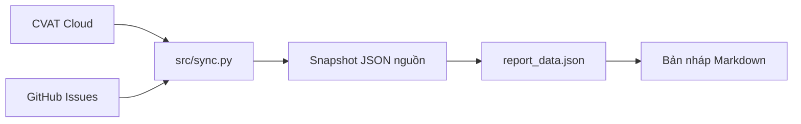

# Tích hợp CVAT–GitHub và bản nháp báo cáo mentor

> **Phạm vi tài liệu:** PR này chỉ thay đổi docs/03-integrations/. Code và cấu hình main được giữ nguyên. CVAT Cloud PAT cần Bearer nhưng extractor trên main hiện vẫn dùng Token; bản sửa nằm ở nhánh feature/cvat-github-integration và cần review riêng trước khi chạy live với PAT. Offline vẫn chạy được.

**Đề tài: Tự động soạn báo cáo trước phiên mentor.**

Project đọc CVAT Cloud và GitHub, lưu snapshot, xác minh liên kết issue với task/job và tạo bản nháp Markdown. Một lần chạy hiện xử lý **một task và một repo**.

## Bắt đầu ở đâu?

| Nhu cầu | Tài liệu |
|---|---|
| Cài đặt và chạy | README này |
| Hiểu từng trường output | [Hợp đồng dữ liệu v1](DATA_CONTRACT.md) |
| Nhận bàn giao hoặc phát triển tiếp | [Bàn giao và việc còn lại](HANDOFF.md) |
| Xem thiết kế tổng thể của nhóm | [Danh mục tài liệu](../README.md) |

## Trạng thái hiện tại

| Phần | Đã có | Giới hạn |
|---|---|---|
| CVAT | Task, jobs, labels, issues/comments, annotations theo job | Không tải ảnh, không nội suy tracks |
| GitHub | Issues mở/đóng, labels, comments; nhóm ca khó/câu hỏi/blocker/guideline | Không lấy events/timeline hoặc PRs/commits |
| Liên kết | Đọc task/job và frame từ issue; kiểm tra job thuộc task | Frame được đọc nhưng chưa kiểm tra phạm vi hay nội dung |
| Báo cáo | JSON chuẩn hóa, Markdown bốn mục; thử đọc metadata Quality Report | Điểm QA chưa kiểm chứng đầy đủ, % hoàn thành theo frame chưa có |
| Vận hành | CLI, snapshot, timeout/retry/phân trang | Chưa có lịch chạy, nhật ký soạn/nộp hay thông báo |

Bản integration local trước đây đã chạy với task thử `2592622` và repo `DuyWebdev/annotation-qa-tracker`. Tài liệu này được đối chiếu với cấu trúc module của main ngày 16/10/2026; kết quả thử bản local không thay thế kiểm chứng API thật cho bản refactor. Đây là integration v1, chưa phải sản phẩm hoàn chỉnh. Tài liệu kiến trúc, Power BI và automation mô tả hướng phát triển của nhóm.



Chương trình chỉ đọc nguồn và lưu local; tên `sync.py` không có nghĩa đồng bộ hai chiều.

## Cài đặt và cấu hình

Yêu cầu Python 3.10+. Mở PowerShell tại thư mục gốc project:

```powershell
py -m venv .venv
.\.venv\Scripts\python.exe -X utf8 -m pip install requests python-dotenv
if (-not (Test-Path .env)) { Copy-Item .env.example .env }
```

Không cần activate venv. requests và python-dotenv đủ cho CLI integration; requirements.txt của repo có thêm dependencies cho các phần khác.

Mở `.env` và điền:

```dotenv
CVAT_HOST=https://app.cvat.ai
CVAT_TOKEN=<PAT của tài khoản có quyền đọc task>
CVAT_TASK_ID=2592622
CVAT_ORG=
GITHUB_REPO=DuyWebdev/annotation-qa-tracker
GITHUB_TOKEN=
```

| Biến | Cách dùng |
|---|---|
| CVAT_HOST | URL CVAT, dùng HTTPS |
| CVAT_TOKEN | PAT thật; xem lưu ý xác thực ở đầu tài liệu trước khi chạy live |
| CVAT_TASK_ID | Task có quyền đọc; thay số thử bằng task của nhóm |
| CVAT_ORG | Trống cho workspace cá nhân, slug cho organization |
| GITHUB_REPO | OWNER/REPO |
| GITHUB_TOKEN | Trống khi đọc public; private cần token có quyền đọc |

Các biến username/password, LLM hoặc notifier trong `.env.example` chưa được luồng hiện tại sử dụng. Không commit `.env`; Save annotations trên CVAT trước khi lấy.

## Chạy và xem kết quả

```powershell
.\.venv\Scripts\python.exe -X utf8 src/sync.py --session "Phiên mentor thử"
```

Đổi phạm vi mà không sửa `.env`:

```powershell
.\.venv\Scripts\python.exe -X utf8 src/sync.py --task-id 2592622 --repo DuyWebdev/annotation-qa-tracker
```

Mỗi lần chạy tạo thư mục mới:

```text
data/raw/<UTC timestamp>/
├── manifest.json             # Phạm vi, thời điểm, trạng thái nguồn
├── cvat.json                 # Dữ liệu CVAT và annotations
├── github.json               # Issues, labels, comments
├── links.json                # Xác minh quan hệ task/job
├── report_data.json          # Đầu vào chính cho xử lý/BI/báo cáo
└── MENTOR_REPORT_DRAFT.md     # Bản nháp cho nhóm trưởng
```

Xem đường dẫn `Snapshot Folder:` / `Report File:` trong terminal. CLI có thêm `--output` để chọn thư mục lưu; nếu có thư mục reports/, bản nháp còn được ghi tại reports/MENTOR_REPORT_DRAFT.md. Markdown có bốn mục: **tiến độ batch**, **điểm chấm**, **ca khó kèm link job**, **câu hỏi mở**. Mục thiếu dữ liệu ghi rõ, không tự điền điểm hoặc tiến độ giả.

Kiểm tra manifest: nguồn success, annotations.failed_jobs bằng 0 và các liên kết nghiệp vụ không lỗi. CVAT success chưa bảo đảm mọi job lấy được annotations. `sync.py` hiện trả exit code 1 khi nguồn chính failed; annotations partial hoặc liên kết lỗi có thể vẫn exit 0. Vì vậy phải kiểm tra manifest/links thay vì chỉ nhìn exit code hoặc thông báo hoàn tất. Lỗi đọc comments/Quality Reports hiện có thể bị bỏ qua trong extractor, nên success chưa bảo đảm các phần tùy chọn đầy đủ.

## Test offline với snapshot

Clone code **không có dataset**. Bản main hiện chưa ignore data/raw/; không stage hoặc commit snapshot thật. Cần bổ sung quy tắc ignore khi tích hợp phần code. Nhận snapshot qua kênh chia sẻ của nhóm, giải nén vào `data/raw/`, rồi chạy từ gốc project:

```powershell
.\.venv\Scripts\python.exe -X utf8 src/sync.py --offline data/raw/TEN_SNAPSHOT --session "Demo offline"
```

Thay `TEN_SNAPSHOT` bằng thư mục thật. Không cần token hoặc gọi API. Lệnh ghi lại report_data.json và Markdown trong snapshot đó, giữ nguyên JSON nguồn.

Kiểm thử tự động, không cần tài khoản CVAT:

```powershell
.\.venv\Scripts\python.exe -X utf8 -m unittest discover -s tests
```

## Quy ước GitHub

| Issue mở | Mục báo cáo |
|---|---|
| Label ca-kho | Ca khó |
| Label mentor-question | Câu hỏi mở |

Issue có cả hai labels xuất hiện ở cả hai mục. Title bắt đầu `[API test]` hoặc label `api-test` bị loại; issue tham chiếu task khác cũng bị loại khi đọc được ID. Comments giữ raw; mô tả hiện lấy body issue.

Để xác minh liên kết, mỗi loại ID có đúng một dòng số nguyên dương:

```text
CVAT task ID: 2592622
CVAT job ID: 4475446
```

Có thể thêm dòng `Frame index: 142` để tạo link có ?frame=142; CLI chỉ đọc số, chưa xác minh frame. Câu hỏi chung có thể không có ID, vẫn giữ kèm cảnh báo. Mẫu nhập nằm ở [tracker-templates](tracker-templates/README.md); cần đưa riêng vào repo tracker và tạo labels.

## Những số liệu chưa có

Giờ làm việc thực, ngày nộp job, lịch sử review, % hoàn thành theo frame và thời gian soạn/nộp chưa tích hợp. Code đã thử đọc metadata Quality Report nhưng chưa tải nội dung report/conflicts hoặc xác nhận điểm QA có ý nghĩa với nhóm. Số shapes/tracks không phải frame hoàn thành; verified chỉ xác nhận task/job. Xem [HANDOFF](HANDOFF.md) để biết nguồn cần khảo sát và đầu việc tiếp theo.
