# 🎬 KỊCH BẢN VIDEO DEMO SẢN PHẨM (TỐI ĐA 3 PHÚT)
## AUTO ANNOTATION REPORTER — VINAI BUILD PHASE 2026

> **Dự án**: [Auto Annotation Reporter (CVAT & GitHub Sync - Power BI Hybrid)](../../README.md)  
> **Thời lượng video**: **02 phút 55 giây** (Chuẩn quy định $\le$ 3 phút)  
> **Người thuyết minh**: Đinh Công Minh (Project Lead & BI Architect)  
> **Định dạng video**: MP4 Full HD 1080p (60fps), tỉ lệ 16:9  
> **Link Video Demo (Chính thức)**: [https://youtu.be/auto-annotation-reporter-demo](https://youtu.be/auto-annotation-reporter-demo) *(hoặc cập nhật link YouTube / Google Drive / Loom của nhóm)*

---

## ⏱️ PHÂN BỔ THỜI LƯỢNG (TIMELINE BREAKDOWN)

```mermaid
gantt
    title Phân bổ thời lượng Video Demo (Tổng: 2 phút 55 giây)
    dateFormat X
    axisFormat %s"s"
    section Kịch Bản
    01. Bối cảnh & Điểm nghẽn thực tế      :active, 0, 35
    02. Kiến trúc & 1-Click Pipeline Auto  : 35, 75
    03. Live Demo 5 Trang Dashboard PBI    : 75, 130
    04. AI Summarizer & Độ tin cậy Kỹ thuật: 130, 165
    05. Giá trị Doanh nghiệp & Lời kết     : 165, 175
```

---

## 📝 KỊCH BẢN PHÂN CẢNH CHI TIẾT TỪNG GIÂY (SHOT-BY-SHOT SCRIPT)

---

### 🎬 PHÂN CẢNH 1: ĐẶT VẤN ĐỀ & BÀI TOÁN THỰC TẾ (0:00 - 0:35)

* **Thời lượng**: 35 giây (0:00 $\to$ 0:35)
* **Hình ảnh trên màn hình (Visual Cue)**:
  - (0:00 - 0:10): Màn hình tiêu đề dự án với logo công nghệ chuyển động: *Auto Annotation Reporter - VinAI Build Phase*.
  - (0:10 - 0:25): Quay màn hình cảnh một annotator đang thao tác vẽ box trên CVAT, song song bên cạnh là danh sách GitHub Issues với các nhãn `ca-kho`, `blocker`. Sau đó mở bảng tính Excel dày đặc số liệu, thao tác gõ công thức thủ công.
  - (0:25 - 0:35): Hiệu ứng làm nổi bật 4 điểm nghẽn: Phân mảnh dữ liệu, mất 2-4 tiếng tổng hợp, trôi lỗi ca khó, thiếu kho lưu trữ kiểm toán.
* **Lời thoại thuyết minh (Voiceover)**:
  > *"Xin chào Ban Giám Khảo và các Mentor! Trong các dự án Thị giác máy tính lớn, khâu gán nhãn dữ liệu quyết định tới 80% chất lượng của mô hình AI. Thế nhưng, vận hành gán nhãn hiện nay đang đối mặt với một nghịch lý: tiến độ và bounding box thì nằm trên CVAT, còn tranh cãi kỹ thuật và ca khó lại nằm trên GitHub Issues. Mỗi tuần, các trưởng nhóm mất từ 2 đến 4 giờ chỉ để xuất CSV, đếm frame và tính toán thủ công trên Excel trước mỗi phiên họp, trong khi những khung hình lỗi gây tranh chấp thì dễ dàng bị trôi mất. Đó chính là lý do chúng tôi phát triển **Auto Annotation Reporter**!"*

---

### 🎬 PHÂN CẢNH 2: KIẾN TRÚC GIẢI PHÁP & 1-CLICK PIPELINE (0:35 - 1:15)

* **Thời lượng**: 40 giây (0:35 $\to$ 1:15)
* **Hình ảnh trên màn hình (Visual Cue)**:
  - (0:35 - 0:50): Chiếu sơ đồ kiến trúc tổng thể 5 tầng (Trigger $\to$ Ingestion $\to$ Medallion SQLite $\to$ Analytics Engine $\to$ Power BI). Zoom vào 3 tầng Bronze $\to$ Silver $\to$ Gold.
  - (0:50 - 1:05): Quay màn hình desktop, con trỏ chuột bấm đúp vào file `START_AUTO.cmd`. Terminal hiện ra chạy mượt mà: tạo môi trường, nạp 1.200 frames, tính toán xong trong 0.8 giây, và bảng điều khiển bật lên ngay lập tức.
  - (1:05 - 1:15): Mở thư mục `data/annotation_warehouse.db`, hiển thị cấu trúc Star Schema chuẩn chỉnh trên SQLite.
* **Lời thoại thuyết minh (Voiceover)**:
  > *"Auto Annotation Reporter là một hệ sinh thái khép kín theo chuẩn Enterprise Data Lakehouse. Hệ thống tự động thu thập API từ cả CVAT và GitHub có cơ chế Retry thông minh và chống rò rỉ bảo mật. Dữ liệu thô được đưa vào Kho Medallion 3 lớp trên SQLite: tầng Bronze lưu vết kiểm toán toàn vẹn, tầng Silver làm sạch thực thể và tầng Gold tổ chức theo mô hình hình sao Star Schema. Đặc biệt, người dùng chỉ cần một cú click chuột vào file `START_AUTO.cmd`, toàn bộ pipeline từ nạp dữ liệu đến kích hoạt Power BI DirectQuery đều được khởi động tự động trong chưa đầy 1 giây!"*

---

### 🎬 PHÂN CẢNH 3: LIVE DEMO 5 TRANG DASHBOARD POWER BI & DEEP LINK (1:15 - 2:10)

* **Thời lượng**: 55 giây (1:15 $\to$ 2:10)
* **Hình ảnh trên màn hình (Visual Cue)**:
  - (1:15 - 1:25): **Trang 1: Executive 360** — Lướt qua các thẻ KPI: Tiến độ 80%, Vận tốc trung bình 45 frames/giờ, Đồng hồ dự báo hoàn thành (ETA Completion Window).
  - (1:25 - 1:35): **Trang 2: QA Deep-Dive** — Thao tác click vào tỷ lệ FTPR (88.5%), biểu đồ phân loại 4 nhóm lỗi gán nhãn (Lệch tọa độ, Gán sai nhãn, Bỏ sót vật thể, Vi phạm guideline).
  - (1:35 - 1:45): **Trang 3: People Matrix** — Phóng to biểu đồ phân tán Scatter Plot 2 trục (Tốc độ vs Chất lượng). Rê chuột vào nhóm 'Ngôi sao hiệu suất' và nhóm 'Cần đào tạo lại'.
  - (1:45 - 1:55): **Trang 4: Geometry & COCO Scale** — Chỉ rõ phân bổ diện tích vật thể theo công thức Shoelace Gauss, tương quan tỷ lệ lỗi tăng cao ở các vật thể siêu nhỏ (COCO Small).
  - (1:55 - 2:10): **Trang 5: Edge-Case Explorer** — **TÍNH NĂNG ĐINH CAO**: Con trỏ chuột bấm vào nút **[Mở Frame CVAT]** của một issue ca khó. Trình duyệt lập tức bật lên mở đúng task trên CVAT với URL `?frame=142`, phóng to ngay tại vị trí khung hình gây tranh cãi.
* **Lời thoại thuyết minh (Voiceover)**:
  > *"Bản báo cáo trực quan 5 trang trên Power BI mang đến cái nhìn toàn cảnh 360 độ: từ tiến độ tổng thể, phân tích chất lượng sâu, ma trận phân khúc 7 nhóm nhân sự, đến hình học vật thể gán nhãn. Và đây chính là điểm đột phá nhất của chúng tôi: Trang Edge-Case Explorer đồng bộ danh sách ca khó từ GitHub. Khi Leader hoặc Mentor bấm vào nút 'Mở Frame CVAT', hệ thống tự động điều hướng thẳng vào đúng khung hình lỗi trên CVAT web nhờ công nghệ Deep Link cấp độ Frame. Không còn bất kỳ sự mơ hồ hay mất dấu ca khó nào trong các buổi nghiệm thu!"*

---

### 🎬 PHÂN CẢNH 4: AI ENGINE & ĐỘ TIN CẬY KỸ THUẬT (2:10 - 2:40)

* **Thời lượng**: 30 giây (2:10 $\to$ 2:40)
* **Hình ảnh trên màn hình (Visual Cue)**:
  - (2:10 - 2:20): Mở file `reports/MENTOR_REPORT_DRAFT.md`. Cuộn nhanh qua phần Executive Summary được tổng hợp bởi mô hình Gemini LLM từ phản ánh của 4 tổ gán nhãn (Team Xe con, Xe tải, QA, Ca đêm).
  - (2:20 - 2:30): Mở terminal chạy lệnh `python -m pytest tests -v`. Kết quả xanh lá cây hiện ra tức thì: `136 passed in 2.57s`.
  - (2:30 - 2:40): Màn hình đối soát JSON: `20/20 DAX Measures MATCH (0.0000% difference)`.
* **Lời thoại thuyết minh (Voiceover)**:
  > *"Bên cạnh Dashboard trực quan, hệ thống tích hợp sẵn mô hình Gemini LLM để tự động đọc văn bản phản ánh của các tổ nhóm, cô đọng thành bản báo cáo điều hành gửi Mentor trước 24 giờ. Về chất lượng kỹ thuật, dự án đã vượt qua toàn bộ 136 bài Unit Tests tự động với tỷ lệ pass 100% chỉ trong 2.5 giây. Toàn bộ 20 công thức DAX trong Power BI đều được đối soát kép với mã nguồn Python với độ sai lệch hoàn hảo 0.0000%!"*

---

### 🎬 PHÂN CẢNH 5: HIỆU QUẢ HOẠT ĐỘNG, ĐỊNH HƯỚNG & LỜI KẾT (2:40 - 2:55)

* **Thời lượng**: 15 giây (2:40 $\to$ 2:55)
* **Hình ảnh trên màn hình (Visual Cue)**:
  - (2:40 - 2:50): Bảng tổng kết số liệu ấn tượng: Nhanh hơn 12.000 lần, Tiết kiệm 4 giờ/tuần, Zero-Ops hạ tầng. Lộ trình phát triển mở rộng sang Label Studio và Smart Task Routing.
  - (2:50 - 2:55): Màn hình cảm ơn Ban Giám Khảo, hiện mã QR và đường link truy cập Live Demo Web và GitHub Repository.
* **Lời thoại thuyết minh (Voiceover)**:
  > *"Từ 4 giờ tổng hợp thủ công rút ngắn xuống dưới 1 giây, tiết kiệm 100% chi phí máy chủ, Auto Annotation Reporter sẵn sàng triển khai ngay vào thực tế để nâng tầm vận hành dữ liệu AI. Xin chân thành cảm ơn Ban Giám Khảo và các Mentor đã chú ý lắng nghe!"*

---

## 📌 HƯỚNG DẪN QUAY & XUẤT VIDEO (FOR RECORDING TEAM)

1. **Công cụ thu hình đề xuất**: OBS Studio (Open Broadcaster Software) hoặc Camtasia với độ phân giải màn hình 1920x1080.
2. **Âm thanh**: Sử dụng micro chống ồn, giọng đọc truyền cảm, tốc độ nói vừa phải (khoảng 140 - 150 từ/phút).
3. **Thao tác chuột**: Bật chế độ Mouse Highlighter (vòng tròn màu vàng quanh con trỏ chuột) để người xem dễ theo dõi thao tác click.
4. **Cắt dựng**: Thêm nhạc nền nhẹ nhàng (Background Lo-Fi / Corporate Tech ambient ở mức âm lượng -24dB), không lấn át giọng nói.
