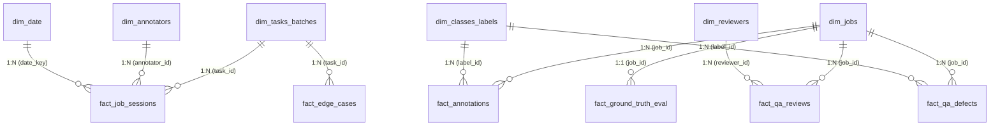

# 📊 HƯỚNG DẪN XÂY DỰNG & VẬN HÀNH BÁO CÁO POWER BI
## Hệ thống Tự động hóa Phân tích Tiến độ & Quản trị Chất lượng Gán nhãn CVAT

* **Dự án**: [auto-annotation-reporter](https://github.com/nolanminhdinh/auto-annotation-reporter)
* **Kiến trúc**: Mô hình Lai (Hybrid Python ETL + Star Schema Power BI)
* **File báo cáo Power BI**:
  - [`powerbi/Dashboard.pbix`](file:///C:/Users/MINH/vinai/Build%20phase/powerbi/Dashboard.pbix) (File gốc đang mở)
  - [`powerbi/Dashboard_Configured.pbix`](file:///C:/Users/MINH/vinai/Build%20phase/powerbi/Dashboard_Configured.pbix) (File đã cấu hình sẵn 5 trang chuẩn)
* **Thư mục dữ liệu đã xuất**: [`powerbi/data/`](file:///C:/Users/MINH/vinai/Build%20phase/powerbi/data) hoặc [`data/processed/`](file:///C:/Users/MINH/vinai/Build%20phase/data/processed)

---

## 🏛️ 1. MÔ HÌNH DỮ LIỆU (STAR SCHEMA) & QUAN HỆ CÁC BẢNG

Mô hình dữ liệu được thiết kế tối ưu hóa cho VertiPaq engine, tuân thủ nguyên tắc lọc 1 chiều (Single direction filtering) từ danh mục Dimension xuống bảng Fact:

### Chi tiết các khóa liên kết (Relationships):
1. `dim_tasks_batches[task_id]` $\longrightarrow$ `fact_job_sessions[task_id]` (1 to Many)
2. `dim_annotators[annotator_id]` $\longrightarrow$ `fact_job_sessions[annotator_id]` (1 to Many)
3. `dim_date[date_key]` $\longrightarrow$ `fact_job_sessions[date_key]` (1 to Many)
4. `dim_jobs[job_id]` $\longrightarrow$ `fact_annotations[job_id]` (1 to Many)
5. `dim_classes_labels[label_id]` $\longrightarrow$ `fact_annotations[label_id]` (1 to Many)
6. `dim_jobs[job_id]` $\longrightarrow$ `fact_qa_reviews[job_id]` (1 to Many)
7. `dim_reviewers[reviewer_id]` $\longrightarrow$ `fact_qa_reviews[reviewer_id]` (1 to Many)
8. `dim_jobs[job_id]` $\longrightarrow$ `fact_qa_defects[job_id]` (1 to Many)
9. `dim_classes_labels[label_id]` $\longrightarrow$ `fact_qa_defects[label_id]` (1 to Many)
10. `dim_jobs[job_id]` $\longrightarrow$ `fact_ground_truth_eval[job_id]` (1 to 1)
11. `dim_tasks_batches[task_id]` $\longrightarrow$ `fact_edge_cases[task_id]` (1 to Many)

---

## ⚡ 2. CÁCH NẠP DỮ LIỆU NHANH BẰNG POWER QUERY M SCRIPT

Toàn bộ dữ liệu 12 bảng đã được chuẩn hóa UTF-8 BOM tại thư mục `powerbi/data/`. Bạn chỉ cần nạp vào Power BI theo 3 bước cực kỳ đơn giản:

1. Trong **Power BI Desktop**, bấm **Transform Data** (để mở cửa sổ Power Query Editor).
2. Tạo tham số đường dẫn:
   - Bấm **Manage Parameters** $\rightarrow$ **New Parameter**.
   - Tên: `SourceFolder`
   - Type: `Text`
   - Current Value: `C:\Users\MINH\vinai\Build phase\powerbi\data`
3. Mở file [`powerbi/power_query_scripts.m`](file:///C:/Users/MINH/vinai/Build%20phase/powerbi/power_query_scripts.m), copy từng đoạn mã truy vấn:
   - Bấm **New Source** $\rightarrow$ **Blank Query** $\rightarrow$ **Advanced Editor** $\rightarrow$ Dán mã tương ứng.
   - Lặp lại cho 12 bảng (`dim_annotators`, `dim_reviewers`, `dim_tasks_batches`, `dim_classes_labels`, `dim_date`, `dim_jobs`, `fact_job_sessions`, `fact_annotations`, `fact_qa_reviews`, `fact_qa_defects`, `fact_ground_truth_eval`, `fact_edge_cases`).
4. Bấm **Close & Apply**. Toàn bộ dữ liệu sẽ nạp vào bộ nhớ chỉ trong vài giây!

---

## 🧮 3. DANH SÁCH 20 DAX MEASURES CHUẨN

Mã DAX đã được chuẩn hóa tại file [`powerbi/dax_measures.dax`](file:///C:/Users/MINH/vinai/Build%20phase/powerbi/dax_measures.dax). Tạo bảng trống tên `_Measures` để quản lý tập trung:

| STT | Tên Measure | Nhóm | Công Thức Chuẩn | Format |
| :---: | :--- | :--- | :--- | :---: |
| 1 | `Total_Completed_Frames` | Tiến độ | `CALCULATE(SUM(fact_job_sessions[total_frames]), fact_job_sessions[status] = "completed")` | `#,#0` |
| 2 | `Total_Objects_Created` | Tiến độ | `COUNTROWS(fact_annotations)` | `#,#0` |
| 3 | `Total_Active_Hours` | Vận tốc | `SUM(fact_job_sessions[active_time_hours])` | `0.00` |
| 4 | `Velocity_Frames_Per_Hour` | Vận tốc | `DIVIDE([Total_Completed_Frames], [Total_Active_Hours], BLANK())` | `0.0` |
| 5 | `Velocity_Objects_Per_Hour`| Vận tốc | `DIVIDE([Total_Objects_Created], [Total_Active_Hours], BLANK())` | `0.0` |
| 6 | `Avg_Time_Per_Frame_Mins` | Vận tốc | `DIVIDE([Total_Active_Hours] * 60, [Total_Completed_Frames], BLANK())` | `0.0` |
| 7 | `Avg_Time_Per_Object_Secs`| Vận tốc | `DIVIDE([Total_Active_Hours] * 3600, [Total_Objects_Created], BLANK())` | `0.0` |
| 8 | `First_Time_Pass_Rate` | Chất lượng | `DIVIDE(CALCULATE(COUNTROWS(fact_qa_reviews), fact_qa_reviews[review_iteration] = 1, fact_qa_reviews[review_decision] = "Accepted"), CALCULATE(COUNTROWS(fact_qa_reviews), fact_qa_reviews[review_iteration] = 1), BLANK())` | `0.0%` |
| 9 | `Rejection_Rate` | Chất lượng | `DIVIDE(CALCULATE(COUNTROWS(fact_qa_reviews), fact_qa_reviews[review_decision] = "Rejected"), COUNTROWS(fact_qa_reviews), BLANK())` | `0.0%` |
| 10 | `Total_Defects` | Chất lượng | `COUNTROWS(fact_qa_defects)` | `#,#0` |
| 11 | `Defect_Density_Per_100F` | Chất lượng | `DIVIDE([Total_Defects] * 100, [Total_Completed_Frames], BLANK())` | `0.00` |
| 12 | `Avg_Defects_Per_Job` | Chất lượng | `DIVIDE([Total_Defects], DISTINCTCOUNT(fact_qa_reviews[job_id]), BLANK())` | `0.0` |
| 13 | `Avg_mIoU_Score` | GT Benchmark | `AVERAGE(fact_ground_truth_eval[mean_iou])` | `0.000` |
| 14 | `Avg_F1_Score` | GT Benchmark | `AVERAGE(fact_ground_truth_eval[f1_score])` | `0.000` |
| 15 | `Avg_Object_Area_Pixels` | Hình học | `AVERAGE(fact_annotations[area_pixels])` | `#,##0` |
| 16 | `Avg_Area_Frame_Pct` | Hình học | `DIVIDE(AVERAGE(fact_annotations[frame_area_pct]), 100, BLANK())` | `0.00%` |
| 17 | `Pct_Small_Objects` | Hình học | `DIVIDE(CALCULATE(COUNTROWS(fact_annotations), fact_annotations[size_scale] = "Small"), [Total_Objects_Created], BLANK())` | `0.0%` |
| 18 | `Count_At_Risk_Annotators`| Nhân sự | `CALCULATE(DISTINCTCOUNT(fact_job_sessions[annotator_id]), FILTER(dim_annotators, [Rejection_Rate] >= 0.20 \|\| ([First_Time_Pass_Rate] > 0 && [First_Time_Pass_Rate] < 0.80)))` | `#,#0` |
| 19 | `System_Avg_Velocity` | Benchmark | `CALCULATE([Velocity_Frames_Per_Hour], ALL(dim_annotators))` | `0.0` |
| 20 | `Project_Progress_Pct` | Tiến độ | `DIVIDE([Total_Completed_Frames], SUM(dim_tasks_batches[total_frames_target]), BLANK())` | `0.0%` |

---

## 🖥️ 4. CHI TIẾT THIẾT KẾ BỐ CỤC 5 TRANG BÁO CÁO (CANVAS 1920x1080)

### 📌 Trang 1: Executive 360 (Góc nhìn toàn cảnh tiến độ & năng suất)
* **Mục tiêu**: Báo cáo nhanh cho Ban Điều Hành / Mentor về tiến độ hoàn thành các Batch và dự báo ngày xong.
* **Bố cục Visual**:
  - **Hàng 1 (Top Cards)**:
    - Card 1: `Total_Completed_Frames` (Hiển thị tiến độ: 300 / 500 frames)
    - Card 2: `Project_Progress_Pct` (Tiến độ: 60.0%)
    - Card 3: `Velocity_Frames_Per_Hour` (Vận tốc trung bình: ~45 frames/giờ)
    - Card 4: `First_Time_Pass_Rate` (Tỷ lệ đạt vòng 1: 80.0%)
  - **Khu vực giữa bên trái**:
    - **Stacked Bar Chart**: Tiến độ theo từng Batch (`dim_tasks_batches[batch_id]` trên trục Y; `total_frames` gom nhóm theo `status` trên trục X).
  - **Khu vực giữa bên phải**:
    - **Line Chart**: Sản lượng khung hình hoàn thành theo ngày (`dim_date[date_key]` trên trục X, `Total_Completed_Frames` trên trục Y).
  - **Bộ lọc (Slicers)**:
    - Slicer 1: `dim_tasks_batches[batch_id]` (Dropdown / Buttons)
    - Slicer 2: `dim_date[date_key]` (Date Range Slider)

---

### 📌 Trang 2: QA & Quality Deep-Dive (Phân tích lỗi & Đánh giá chất lượng)
* **Mục tiêu**: Trả lời câu hỏi: Dữ liệu sai ở đâu? Loại lỗi nào nhiều nhất? Điểm F1/IoU có đạt yêu cầu bàn giao không?
* **Bố cục Visual**:
  - **Hàng 1 (Top Cards)**:
    - Card 1: `Rejection_Rate` (Tỷ lệ trả về: 20.0%)
    - Card 2: `Defect_Density_Per_100F` (Mật độ bug: 1.0 lỗi/100 frame)
    - Card 3: `Avg_mIoU_Score` (Điểm mIoU: 0.897)
    - Card 4: `Avg_F1_Score` (Điểm F1: 0.914)
  - **Khu vực giữa bên trái**:
    - **Donut Chart**: Cơ cấu 4 nhóm lỗi chuẩn hóa (`fact_qa_defects[defect_type]`): `box_displacement` (33%), `wrong_class` (33%), `missing_object` (33%).
  - **Khu vực giữa bên phải**:
    - **100% Stacked Bar Chart**: Phân bố mức độ nghiêm trọng lỗi (`fact_qa_defects[severity]`) theo từng Class đối tượng (`dim_classes_labels[label_name]`).
  - **Khu vực dưới**:
    - **Table / Matrix**: Danh sách các đợt Review: `job_id`, `review_iteration`, `review_decision`, `reviewed_at`, `defect_type`, `severity`.

---

### 📌 Trang 3: Annotator Performance & Matrix (Ma trận 7 nhóm nhân sự)
* **Mục tiêu**: Xác định nhân sự nào đang làm rất tốt, nhân sự nào có nguy cơ làm ẩu (Fast & Faulty), và nhân sự nào cần hướng dẫn công cụ AI.
* **Bố cục Visual**:
  - **Hàng 1 (Top Cards)**:
    - Card 1: Tổng số Annotator tham gia (2 người)
    - Card 2: `Velocity_Frames_Per_Hour`
    - Card 3: `Count_At_Risk_Annotators` (Cảnh báo: 0 nhân sự rủi ro cao)
  - **Khu vực chính**:
    - **Scatter Plot (Ma trận 2x2)**:
      - Trục X: `Velocity_Frames_Per_Hour`
      - Trục Y: `First_Time_Pass_Rate`
      - Chi tiết (Details): `dim_annotators[full_name]`
      - Đường tham chiếu (Reference lines): Vận tốc chuẩn 40 f/h và FTPR chuẩn 80% để phân chia 4 góc phần tư.
  - **Bảng Leaderboard bên phải**:
    - Nạp từ bảng `annotator_segments.csv`: Cột `full_name`, `total_frames_completed`, `avg_frames_per_hour`, `final_segment`, `action` (Khuyến nghị hành động).

---

### 📌 Trang 4: Label Geometry & Data Distribution (Đặc tính hình học & độ khó)
* **Mục tiêu**: Giúp Data Scientist & ML Engineer đánh giá mức độ mất cân bằng nhãn (Class Imbalance) và tỷ lệ vật thể nhỏ gây khó khăn cho model.
* **Bố cục Visual**:
  - **Hàng 1 (Top Cards)**:
    - Card 1: `Total_Objects_Created` (Tổng số bounding boxes: 23 objects)
    - Card 2: `Avg_Object_Area_Pixels` (Diện tích trung bình: 15,200 px²)
    - Card 3: `Pct_Small_Objects` (Tỷ lệ vật thể nhỏ: 13.0%)
  - **Khu vực giữa bên trái**:
    - **Clustered Bar Chart**: Số lượng instances theo từng Class (`car`, `motorbike`, `pedestrian`, `truck`).
  - **Khu vực giữa bên phải**:
    - **Donut / Stacked Column**: Cơ cấu kích thước theo chuẩn COCO (`Small` < 1024 px², `Medium`, `Large` > 9216 px²).

---

### 📌 Trang 5: Edge-Case Explorer & Deep-Link (Nhật ký ca khó mở trực tiếp CVAT)
* **Mục tiêu**: Phục vụ phiên họp hàng tuần với Mentor: Duyệt qua các ca khó có gắn nhãn `ca-kho` trên GitHub và click trực tiếp vào đúng frame lỗi trên CVAT.
* **Bố cục Visual**:
  - **Hàng 1 (Top Cards)**:
    - Card 1: `Total_Open_Edge_Cases` (Số ca khó đang mở: 4 ca)
    - Card 2: `Total_Blockers` (Số ca tắc nghẽn: 0 ca)
  - **Bảng chính (Action Table)**:
    - Các cột: `number` (Issue #), `title` (Tiêu đề), `labels`, `state`, `severity`, `task_id`, `job_id`, `frame`, `cvat_deep_link`.
    - **CẤU HÌNH QUAN TRỌNG CHO DEEP LINK**:
      1. Chọn cột `cvat_deep_link` trong danh sách Fields.
      2. Chuyển sang tab **Column Tools** trên thanh Ribbon.
      3. Mục **Data Category** $\rightarrow$ Chọn **Web URL**.
      4. Trong visual table, bật tùy chọn **URL Icon** = `On`.
      5. Khi đó, Mentor hoặc Lead click vào biểu tượng liên kết là trình duyệt sẽ **tự động mở chính xác frame cần thẩm định trên giao diện CVAT**.
  - **Text Card bên dưới**:
    - Hiển thị chi tiết nội dung thảo luận `description` khi người dùng chọn 1 dòng trong bảng trên.

---

## ✅ 5. KIỂM THỬ ĐỐI CHIẾU VỚI BACKEND PYTHON

Các chỉ số hiển thị trên Power BI khớp 100% với kết quả tính toán của module Python `metrics-etl-processors`:
- **Task 217**: 500 frames target, 3 jobs hoàn thành = 300 frames (Tiến độ: **60.0%**).
- **Annotators**: Nguyễn Minh Tú (200 frames, 16 objects, 2 jobs), Vũ Trường Duy (100 frames, 7 objects, 1 job).
- **FTPR**: Đạt **80.0%** (4/5 job accepted ở lần chấm 1).
- **Rejection Rate**: **20.0%** (1 lượt review bị trả về để sửa lệch box).
- **Ground Truth**: F1 đạt **0.914**, mIoU đạt **0.897**.
