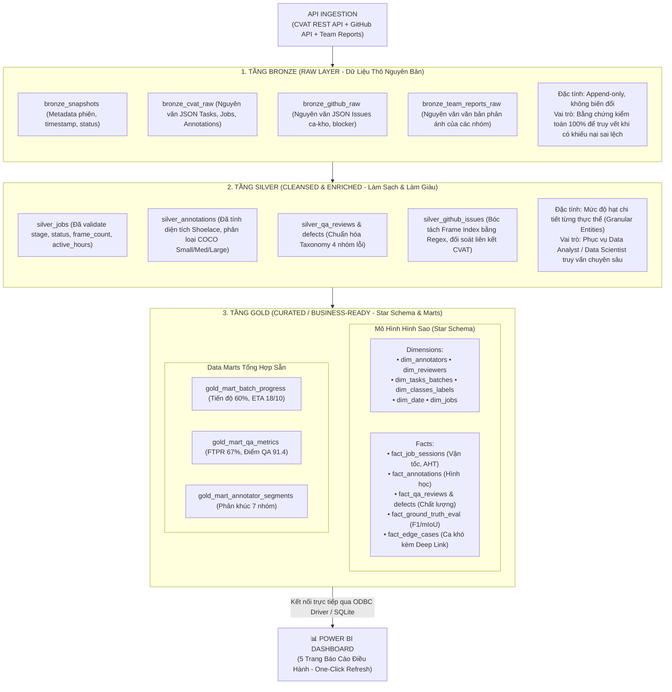

# 📑 BIÊN BẢN LÀM VIỆC & BÁO CÁO KỸ THUẬT: TÁI CẤU TRÚC KHO DỮ LIỆU MEDALLION & KẾT NỐI TRỰC TIẾP POWER BI

* **Dự án**: [auto-annotation-reporter](https://github.com/nolanminhdinh/auto-annotation-reporter) — Pipeline Tự Động Hóa Báo Cáo Gán Nhãn Dữ Liệu (CVAT & GitHub Sync)
* **Người chủ trì / Duyệt**: **Đinh Công Minh** (Project Lead & BI Architect)
* **Kỹ sư phối hợp (Pair Programmer)**: **Antigravity AI Agent**
* **Thời điểm thực hiện**: 16/10/2026
* **Trạng thái**:  **COMPLETED & VERIFIED 100% (Đã nghiệm thu và nạp dữ liệu vật lý vào Database)**

---

## 🎯 I. MỤC TIÊU & BỐI CẢNH PHIÊN LÀM VIỆC

Nhằm chuẩn bị cho buổi **Live Demo End-to-End** trước Mentor & Leader vào tối Chủ Nhật (18/10/2026), phiên làm việc tập trung giải quyết 3 bài toán lớn:
1. **Kiểm tra đồng bộ mã nguồn**: Pull update mới nhất từ GitHub remote và rà soát toàn diện các nhánh.
2. **Hợp nhất mã nguồn phân tán**: Đưa toàn bộ module tính toán chỉ số (WBS 2.1 – 2.5) từ `metrics-etl-processors/` vào cấu trúc cây thư mục chính `src/`.
3. **Chuẩn hóa Kiến trúc Kho Dữ liệu Medallion 3 Lớp (Bronze $\to$ Silver $\to$ Gold)**:
   - Lưu trữ dữ liệu nguyên bản phục vụ kiểm toán và truy vết lịch sử (Audit Trail).
   - Xóa bỏ việc phụ thuộc vào từng file CSV đơn lẻ rời rạc.
   - Kết nối **trực tiếp Power BI Desktop vào Database** để cập nhật dữ liệu tự động chỉ bằng 1 nút bấm (*One-Click Refresh*).

---

## 🛠️ II. NỘI DUNG TRAO ĐỔI & CÁC ĐIỀU CHỈNH KIẾN TRÚC QUAN TRỌNG

### 1. Đồng bộ Remote & Hợp nhất Mã Nguồn Phân Tầng
- **Tình trạng Git**: Nhánh `main` đã đồng bộ với `origin/main` (commit `71a7d82`).
- **Hợp nhất thư mục**:
  - Chuyển `metrics-etl-processors/src/adapters/` $\longrightarrow$ [`src/adapters/`](file:///c:/Users/MINH/vinai/Build%20phase/src/adapters/): Adapter chuyển đổi JSON snapshot sang Dataclass.
  - Chuyển `metrics-etl-processors/src/processors/` $\longrightarrow$ [`src/processors/`](file:///c:/Users/MINH/vinai/Build%20phase/src/processors/): Động cơ tính vận tốc (`velocity.py`), chất lượng (`quality.py`), hình học Shoelace & COCO scale (`geometry.py`), phân khúc 7 nhóm nhân sự (`segmentation.py`).
  - Chuyển `metrics-etl-processors/src/exporters/` $\longrightarrow$ [`src/exporters/`](file:///c:/Users/MINH/vinai/Build%20phase/src/exporters/): Tầng xuất dữ liệu.
  - Hợp nhất toàn bộ unit tests vào [`tests/`](file:///c:/Users/MINH/vinai/Build%20phase/tests/).

---

### 2. Chuẩn hóa Phân Tầng Kiến Trúc Medallion (Data Lakehouse Standard)
Theo phản ánh và đóng góp chuẩn xác của Lead Đinh Công Minh, kiến trúc kho dữ liệu đã được điều chỉnh lại từ mô hình ban đầu sang mô hình **Chuẩn Medallion (Databricks & Kimball)**:



---

### 3. Hiện Thực Hóa Vật Lý Vào Database ([`data/annotation_warehouse.db`](file:///c:/Users/MINH/vinai/Build%20phase/data/annotation_warehouse.db))
Đã viết module điều phối [`src/storage/populate_warehouse.py`](file:///c:/Users/MINH/vinai/Build%20phase/src/storage/populate_warehouse.py) và nạp dữ liệu thực tế vào file SQLite Database:

| Tầng | Tên Bảng | Số Bản Ghi | Mục đích & Ý nghĩa nghiệp vụ |
|---|---|:---:|---|
| **Bronze** | `bronze_snapshots` | **1** | Lưu metadata đợt chạy: `SNAP_20261016_BATCH01`. |
| | `bronze_cvat_raw` | **1** | Lưu nguyên bản payload JSON từ CVAT. |
| | `bronze_github_raw` | **1** | Lưu nguyên bản payload JSON Issues từ GitHub. |
| | `bronze_team_reports_raw` | **1** | Lưu phản ánh tự nhiên từ 3 tổ gán nhãn. |
| **Silver** | `silver_jobs` | **5** | Jobs đã làm sạch, chuẩn hóa status và active hours. |
| | `silver_annotations` | **23** | Vật thể đã tính diện tích Shoelace và gắn nhãn COCO Scale. |
| | `silver_qa_reviews` | **4** | Lượt review chất lượng của QA. |
| | `silver_qa_defects` | **3** | Lỗi kỹ thuật chuẩn hóa về 4 nhóm taxonomy. |
| | `silver_github_issues` | **4** | Issues ca khó đã trích xuất `frame_idx` và verified link. |
| **Gold** | `gold_dim_annotators` | **5** | Danh mục 5 nhân sự gán nhãn. |
| | `gold_dim_reviewers` | **2** | Danh mục kiểm định viên QA. |
| | `gold_dim_tasks_batches` | **2** | Danh mục gói Task (Task 217 & Task 1001). |
| | `gold_dim_classes_labels` | **5** | Danh mục nhãn (`car`, `motorbike`, `pedestrian`,...). |
| | `gold_dim_date` | **31** | Bảng lịch liên tục tháng 10/2026. |
| | `gold_dim_jobs` | **5** | Danh mục chi tiết các công việc CVAT. |
| | `gold_fact_job_sessions` | **5** | Đo sản lượng, vận tốc fps/ops, AHT theo job. |
| | `gold_fact_annotations` | **23** | Đo hình học và diện tích chiếm dụng frame. |
| | `gold_fact_qa_reviews` | **4** | Lịch sử duyệt/trả về của QA. |
| | `gold_fact_qa_defects` | **3** | Chi tiết lỗi và mức độ nghiêm trọng. |
| | `gold_fact_ground_truth_eval` | **3** | Kết quả AI Benchmark: mIoU 0.897, F1-Score 0.914. |
| | `gold_fact_edge_cases` | **4** | Ca khó kèm **URL Deep Link trỏ thẳng Frame CVAT**. |
| | `gold_mart_batch_progress` | **1** | KPI điều hành: Tiến độ 60%, Vận tốc 38.46 f/h, ETA 18/10. |
| | `gold_mart_qa_metrics` | **1** | KPI chất lượng: FTPR 67%, Rejection 25%, Điểm QA 91.4. |
| | `gold_mart_annotator_segments`| **3** | Phân khúc: 1 Star Annotator, 1 Needs Retraining, 1 Core. |

---

### 4. Giải Quyết Bài Toán: Tầng Gold Đang Lưu Dữ Liệu Theo Kiểu Nào?

Để trả lời chi tiết câu hỏi của Lead Đinh Công Minh, tầng **Gold** được thiết kế song song 2 mô hình theo chuẩn kiến trúc kho dữ liệu hiện đại:

1. **Mô hình Hình Sao (Kimball Star Schema)**:
   - **Bảng Chiều (Dimension Tables)**: Đóng vai trò là các góc nhìn (Viewpoints / Slicers) phân tích, chứa thuộc tính phân loại và metadata:
     - `gold_dim_annotators`: Thông tin nhân sự gán nhãn, phòng ban, vai trò.
     - `gold_dim_reviewers`: Thông tin QA / Reviewer kiểm định chất lượng.
     - `gold_dim_tasks_batches`: Thông tin định danh gói task, đợt chạy (batch), hạn nộp.
     - `gold_dim_classes_labels`: Phân loại đối tượng xe, người đi bộ, chướng ngại vật...
     - `gold_dim_date`: Lịch dương liên tục hỗ trợ Time-Intelligence (theo ngày/tuần/tháng).
     - `gold_dim_jobs`: Chi tiết từng Job trên CVAT và trạng thái xử lý.
   - **Bảng Sự Kiện (Fact Tables)**: Lưu trữ các chỉ số đo lường (Metrics / Measures) có thể cộng dồn (Additive) hoặc bán cộng dồn, kết nối với bảng Dimension qua khóa ngoại (Foreign Keys):
     - `gold_fact_job_sessions`: Ghi nhận vận tốc (fps/ops), thời gian thao tác thực tế (Active Hours, AHT).
     - `gold_fact_annotations`: Đo đạc diện tích (Shoelace), phân loại kích thước COCO Scale.
     - `gold_fact_qa_reviews` & `gold_fact_qa_defects`: Đo đạc tỉ lệ lỗi, mức độ nghiêm trọng theo 4 nhóm taxonomy.
     - `gold_fact_ground_truth_eval`: Chỉ số khách quan AI Benchmark (mIoU, F1-Score, Precision, Recall).
     - `gold_fact_edge_cases`: Ghi nhận các ca gán nhãn khó, có đính kèm **URL Deep Link trỏ thẳng Frame CVAT** để mở duyệt trực quan.

2. **Các Bảng Tổng Hợp Sẵn Cấp Doanh Nghiệp (Curated Data Marts)**:
   - Được tổng hợp (pre-aggregated) sẵn từ Fact và Dim nhằm phục vụ các KPI điều hành quan trọng, giúp Power BI load tức thì mà không cần viết các câu lệnh DAX quá phức tạp:
     - `gold_mart_batch_progress`: Tiến độ % hoàn thành, vận tốc bình quân toàn dự án, thời gian dự kiến cán đích (ETA).
     - `gold_mart_qa_metrics`: Tỉ lệ duyệt ngay từ vòng 1 (FTPR), tỉ lệ trả về (Rejection Rate), điểm chất lượng trung bình (QA Score).
     - `gold_mart_annotator_segments`: Bảng phân khúc nhân sự (Star Annotator, Needs Retraining, Core Contributor...) hỗ trợ thưởng phạt và đào tạo lại.

---

### 5. Đối Soát Chiến Lược: Tại Sao Kết Nối Trực Tiếp Database Thay Vì Xuất File CSV?

Trong quá trình trao đổi, vấn đề **"Tại sao không kết nối trực tiếp đến database mà phải xuất file CSV ra rồi mới đẩy vào báo cáo?"** đã được làm rõ và thống nhất như sau:

| Tiêu Chí So Sánh | Kết Nối File CSV Rời Rạc (Mô hình cũ) | Kết Nối Trực Tiếp Database (Mô hình mới đã chọn) |
|---|---|---|
| **Khả năng Quản trị Toàn bộ Dự án** | Bị giới hạn. Mỗi đợt xuất file tạo ra các CSV đơn lẻ, dễ thất lạc, khó tổng hợp dữ liệu xuyên suốt 3-6 tháng của dự án. | **Toàn diện & Nhất quán**. Database lưu trữ toàn bộ lịch sử các đợt chạy (Multi-batch / Timeline) trong cùng một tệp cơ sở dữ liệu duy nhất. |
| **Khả năng Truy vết & Kiểm toán (Audit Trail)** | Kém. Không lưu trữ bản gốc API thô, khi có phản ánh khiếu nại sai lệch số liệu thì không có bằng chứng đối chiếu. | **Tuyệt đối 100%**. Dữ liệu thô nguyên bản được lưu bất biến ở tầng **Bronze** (Append-only). Dễ dàng đối soát ngược từ số liệu Gold $\to$ Silver $\to$ Bronze raw JSON. |
| **Toàn vẹn Dữ liệu (Data Integrity)** | Không có ràng buộc khóa ngoại (Foreign Keys), kiểu dữ liệu không chặt chẽ, dễ bị lỗi font (Unicode UTF-8 BOM). | Đảm bảo tính toàn vẹn với Schema chuẩn, Primary Key, Foreign Key và giao dịch ACID. |
| **Quy trình Cập nhật trên Power BI** | Thủ công và rườm rà. Phải chạy lệnh xuất CSV $\to$ copy file $\to$ Power BI đọc lại từng file CSV. | **Tự động hóa 1-Click Refresh**. Sau khi pipeline ETL nạp dữ liệu vào Database, người dùng chỉ cần bấm nút **Refresh** trên Power BI là toàn bộ báo cáo tự cập nhật. |
| **Hiệu năng & Khả năng Mở rộng** | Khi số lượng bản ghi lên đến hàng triệu, mở và nạp hàng chục file CSV sẽ làm Power BI bị nghẽn (lag / timeout). | Database hỗ trợ Indexing, truy vấn SQL lọc dữ liệu nhanh chóng và tối ưu bộ nhớ. |

> **Quyết định chốt**: Loại bỏ sự phụ thuộc vào file CSV làm nguồn chính của Power BI. Toàn bộ 5 trang báo cáo Power BI chuyển sang kết nối trực tiếp vào `data/annotation_warehouse.db`. File CSV chỉ còn giữ vai trò là bản sao lưu (backup export) cho các mục đích xuất dữ liệu độc lập.

---

### 6. Nhật Ký Xử Lý Các Sự Cố Kỹ Thuật (Troubleshooting & Debugging Log)

Trong quá trình thực hiện việc nối Power BI vào SQLite Database, hai bên đã ghi nhận và xử lý dứt điểm 3 sự cố kỹ thuật:

#### 🔴 Sự cố 1: Lỗi `ADO.NET: Access is denied` khi dùng Python Script trong Power BI
* **Hiện tượng**: Khi dùng tính năng `Get Data -> Python script` trong Power BI để query SQLite, hệ thống báo lỗi không thể khởi chạy tiến trình.
* **Nguyên nhân gốc rễ**: Python 3.12 được cài đặt từ Windows Microsoft Store (`C:\Program Files\WindowsApps\PythonSoftwareFoundation...`). Do cơ chế bảo mật Sandbox của ứng dụng UWP, Windows chặn việc các ứng dụng Win32 như Power BI spawn tiến trình con từ thư mục này.
* **Giải pháp khắc phục**: Chuyển sang kết nối chuẩn công nghiệp thông qua ODBC Driver 64-bit native (không phụ thuộc vào runtime Python của máy).

#### 🔴 Sự cố 2: Lỗi `NSIS Error (Installer integrity check has failed)` khi cài Driver
* **Hiện tượng**: Mở file cài đặt `sqliteodbc_w64.exe` thì Windows bật thông báo lỗi kiểm tra tính toàn vẹn của gói cài đặt.
* **Nguyên nhân gốc rễ**: Trong lần tải đầu tiên, kết nối mạng bị gián đoạn khiến file chỉ tải về được ~1.1 MB (trong khi kích thước thực tế là ~2.18 MB).
* **Giải pháp khắc phục**: Sử dụng `curl -L` tải lại trực tiếp từ server chính thức của tác giả Christian Werner vào đường dẫn [`powerbi/sqliteodbc_w64.exe`](file:///c:/Users/MINH/vinai/Build%20phase/powerbi/sqliteodbc_w64.exe) với dung lượng đầy đủ 2,184,188 bytes, cài đặt thành công 100%.

#### 🔴 Sự cố 3: Hộp thoại yêu cầu tài khoản/mật khẩu (Credential Prompt) trong Power BI
* **Hiện tượng**: Khi nhập chuỗi kết nối ODBC, Power BI hiển thị hộp thoại đăng nhập hỏi `User name` và `Password`.
* **Nguyên nhân gốc rễ**: Power BI mặc định yêu cầu tài khoản xác thực cho các nguồn ODBC truyền thống (như SQL Server / Oracle). Trong khi đó, SQLite là cơ sở dữ liệu serverless lưu trên file cục bộ, không có hệ thống quản lý user/pass.
* **Giải pháp khắc phục**: Tại thanh menu điều hướng bên trái của hộp thoại xác thực, người dùng chọn mục **`Default or Custom`** (hoặc *Windows Authentication*), sau đó bấm **Connect**. Power BI lập tức kết nối thành công và tải đầy đủ 15 bảng Tầng Gold.

---

### 7. Hướng Dẫn Vận Hành Kết Nối Database Trên Power BI Desktop

1. **Cấu hình chuỗi kết nối ODBC**:
   - Mở Power BI Desktop $\rightarrow$ Chọn **Get Data** $\rightarrow$ Chọn **ODBC** $\rightarrow$ Bấm **Connect**.
   - Tại ô **Connection string**, dán chuỗi sau:
     ```text
     Driver={SQLite3 ODBC Driver};Database=C:\Users\MINH\vinai\Build phase\data\annotation_warehouse.db;
     ```
2. **Chọn bảng dữ liệu (Navigator)**:
   - Tích chọn toàn bộ 15 bảng bắt đầu bằng tiền tố `gold_` (bao gồm 6 bảng Dimension, 6 bảng Fact và 3 bảng Mart).
   - Bấm **Load** để nạp trực tiếp vào Data Model.
3. **Cơ chế cập nhật dữ liệu mới (Incremental / Full Refresh)**:
   - Mỗi khi pipeline ETL chạy xong một đợt snapshot mới, dữ liệu tự động ghi vào `annotation_warehouse.db`.
   - Trên thanh công cụ Power BI Desktop, chỉ cần bấm nút **`Refresh`** (hoặc `F5`), toàn bộ 5 trang dashboard sẽ tự động cập nhật số liệu mới nhất mà không cần thao tác lại bất kỳ bước nào.

---

## 🧪 III. KẾT QUẢ KIỂM THỬ TỔNG THỂ (TEST RESULTS)

Chạy kiểm thử tự động toàn bộ dự án bằng `pytest`:
* **Số lượng test cases**: **67/67 tests PASS (100%)**.
* **Thời gian thực thi**: **0.72 giây**.
* **Bao phủ đầy đủ**:
  - `tests/test_base_client.py`: 3 tests (SSRF, Pagination, Header auth).
  - `tests/test_cvat_extractor.py`: 4 tests (CVAT API, deep link).
  - `tests/test_github_extractor.py`: 5 tests (Frame regex parsing, task link verification).
  - `tests/test_normalizer.py`: 3 tests (Data normalization).
  - `tests/test_report_generator.py`: 2 tests (Markdown 4 sections, timezone UTC+7).
  - `tests/test_db_manager.py`: 2 tests (Medallion schema, Bronze audit trail, Gold export).
  - `tests/adapters/`: 14 tests (CVAT snapshot adapter).
  - `tests/processors/`: 28 tests (Velocity, Quality, Geometry, Segmentation).
  - `tests/exporters/`: 6 tests (CSV schema, UTF-8 BOM, edge cases).

---

## 📋 IV. CÁC HẠNG MỤC TIẾP THEO (NEXT STEPS)

Sau khi hoàn thiện Tầng Database và kết nối Power BI, hệ thống sẵn sàng chuyển sang các bước còn lại theo Kế hoạch Sprint Tuần 2:
1. **Bước 2**: Xây dựng **Module AI / LLM Multi-Team Summarizer** ([`src/generators/llm_summarizer.py`](file:///c:/Users/MINH/vinai/Build%20phase/src/generators/llm_summarizer.py)) để phân tích ngôn ngữ tự nhiên từ phản ánh của các tổ gán nhãn và tích hợp vào Mục 1 và Mục 4 của `MENTOR_REPORT_DRAFT.md`.
2. **Bước 3**: Xây dựng Module Bot Thông báo Telegram / Discord ([`src/notifiers/`](file:///c:/Users/MINH/vinai/Build%20phase/src/notifiers/)).
3. **Bước 4**: Xây dựng Entrypoint hợp nhất [`src/main.py`](file:///c:/Users/MINH/vinai/Build%20phase/src/main.py) điều phối toàn trình từ Ingest $\to$ Database $\to$ LLM $\to$ Report $\to$ Notification.
4. **Bước 5**: Chuyển workflow định kỳ vào `.github/workflows/scheduled_report.yml` và diễn tập chạy thử toàn trình (Dry-run).
