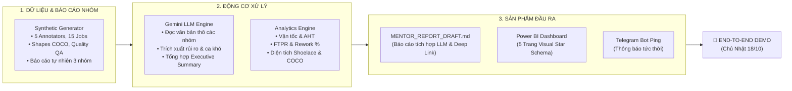

# 🚀 KẾ HOẠCH SPRINT TUẦN 2: TRIỂN KHAI TOÀN TRÌNH & DEMO END-TO-END
## (TÍCH HỢP LLM TÓM TẮT BÁO CÁO NHÓM & POWER BI HYBRID PIPELINE)

> **Dự án**: [auto-annotation-reporter](../../README.md) — Pipeline Tự Động Hóa Báo Cáo Gán Nhãn Dữ Liệu (CVAT & GitHub Sync)  
> **Thời gian thực hiện**: 12/10/2026 – 18/10/2026  
> **Mục tiêu tối thượng**: **20:00 Chủ Nhật (18/10/2026) thực hiện Live Demo End-to-End (E2E)**  
> **Người lập & Phê duyệt**: **Đinh Công Minh** (Project Lead & BI Architect)

---

## 📌 I. TỔNG KẾT NỀN TẢNG ĐÃ THỰC HIỆN (BASELINE CHECK)

Sau khi rà soát toàn bộ dự án, nhóm đã hoàn thành và nghiệm thu xuất sắc các hạng mục nền tảng của Tuần 1:
1. **Kiến trúc & Đặc tả Nghiệp vụ (`docs/`)**:
   - Hoàn chỉnh kiến trúc khép kín 5 giai đoạn: Trigger $\to$ Extract $\to$ Process $\to$ Report $\to$ Review ([`SYSTEM_ARCHITECTURE.md`](../../docs/01-architecture/SYSTEM_ARCHITECTURE.md)).
   - Đặc tả 9 bảng dữ liệu Star Schema và 20 công thức DAX Measures ([`PROJECT_ANALYTICS_SPEC.md`](../../docs/02-data-and-analytics/PROJECT_ANALYTICS_SPEC.md)).
   - Chuẩn đặc tả cấu trúc bản báo cáo 4 mục chuẩn ([`REPORT_TEMPLATE_SPEC.md`](../../docs/02-data-and-analytics/REPORT_TEMPLATE_SPEC.md)).
   - Kế hoạch phân rã WBS và ma trận RACI 5 thành viên ([`PROJECT_MANAGEMENT_PLAN.md`](../../docs/05-project-management/PROJECT_MANAGEMENT_PLAN.md)).
2. **Tầng Thu thập & Nghiệm thu Ingestion Layer (`src/extractors/`)**:
   - [`base_client.py`](../../src/extractors/base_client.py): HTTP Client chuẩn hóa với retry backoff (429/500/502), phân trang an toàn, chống SSRF.
   - [`cvat_extractor.py`](../../src/extractors/cvat_extractor.py): Trích xuất Tasks, Jobs, Assignees, Labels và tóm tắt Annotations (Shapes/Tracks/Tags).
   - [`github_extractor.py`](../../src/extractors/github_extractor.py): Bóc tách GitHub Issues gắn nhãn (`ca-kho`, `mentor-question`, `blocker`), đối soát liên kết Task/Job.
3. **Chuẩn hóa & Báo cáo Markdown Khởi đầu (`src/processors/` & `src/generators/`)**:
   - [`normalizer.py`](../../src/processors/normalizer.py): Chuẩn hóa dữ liệu thành `report_data.json` theo đúng Data Contract v1.
   - [`markdown_generator.py`](../../src/generators/markdown_generator.py): Render bản thảo `MENTOR_REPORT_DRAFT.md` với **Deep Link Frame-Level** (`?frame={idx}` trỏ thẳng tới khung hình gây tranh cãi trên CVAT).
   - Module runner [`sync.py`](../../src/sync.py) hỗ trợ cả Online Sync và Offline Snapshot Replay.
   - **17/17 Unit Tests PASS 100%**.

---

## 🎯 II. CÁC MẢNH GHÉP CẦN HOÀN THIỆN ĐỂ DEMO END-TO-END

Để buổi **Demo toàn trình vào tối Chủ Nhật (18/10/2026)** đạt hiệu quả thuyết phục cao nhất, hệ thống cần bổ sung 3 mắt xích then chốt:



1. **Bộ Dữ liệu Giả lập Chân thực (Rich Synthetic Data Generator)**: Do server CVAT thực tế chưa có đủ số lượng job lớn và Ground Truth, cần module sinh dữ liệu giả lập phong phú: 5 annotators, 15 jobs, 1.200 frames, 3.000 objects (kích thước Small/Medium/Large theo COCO), 20 lượt review (có accept/reject), và text phản ánh tự nhiên từ các tổ gán nhãn.
2. **Module LLM Summarizer (Tổng hợp Báo cáo Ngôn ngữ Tự nhiên của các Nhóm)**: Tự động phân tích các đoạn text phản ánh thô từ các nhóm gán nhãn (Team Xe con, Team Xe tải/Hạ tầng, Team Reviewer, Ca đêm), trích xuất blockers, thắc mắc về guideline và tổng hợp thành bản tóm tắt điều hành chèn vào báo cáo.
3. **ETL Xuất CSV & Hoàn thiện 5 Trang Dashboard Power BI**: Biến đổi `report_data.json` và raw snapshot thành các bảng CSV quan hệ, đưa vào Power BI dựng trực quan 5 trang chuyên nghiệp.
4. **Hợp nhất CLI Entrypoint & Bot Thông báo**: `src/main.py` đóng vai trò nhạc trưởng điều phối toàn bộ luồng, kết nối Bot Telegram gửi thông báo tức thời.

---

## 📅 III. KẾ HOẠCH CHI TIẾT TỪNG NGÀY TRONG TUẦN (12/10 – 18/10/2026)

### 🗓️ THỨ HAI (12/10): KHỞI ĐỘNG SPRINT & XÂY DỰNG SYNTHETIC DATA GENERATOR
* **Mục tiêu**: Có sẵn bộ sinh dữ liệu giả lập chuẩn xác (cả structured data và unstructured natural language text) để toàn đội kiểm thử độc lập.
* **Phân công 5 thành viên**:
  * **Đinh Công Minh (Lead)**:
    - Họp Sprint Planning 30 phút, chốt phạm vi Demo Chủ Nhật.
    - Soạn thảo bộ 10 đoạn báo cáo ngôn ngữ tự nhiên mẫu của các nhóm gán nhãn (phản ánh các ca: camera bị lóa, xe máy điện chiếm ô sạc, tranh cãi guideline xe bị che khuất >70%, lỗi lệch box).
  * **Nguyễn Minh Tú & Vũ Trường Duy**:
    - Xây dựng module `src/generators/mock_data_generator.py`: sinh dữ liệu giả lập `cvat_raw.json`, `github_issues.json`, và `team_reports.json`.
    - Bảo đảm dữ liệu giả lập mô phỏng đầy đủ 5 nhân sự, 15 jobs, điểm Ground Truth, lịch sử review accept/reject.
  * **Phạm Nguyễn Tuân**:
    - Khởi tạo khung các module tính toán chỉ số `src/processors/velocity.py`, `quality.py`, `geometry.py`.
  * **Ngô Duy Ngọc**:
    - Tạo nhánh Git: `feature/synthetic-data`, `feature/llm-summary`, `feature/powerbi-etl`.

---

### 🗓️ THỨ BA (13/10): XÂY DỰNG ĐỘNG CƠ LLM TÓM TẮT BÁO CÁO NHÓM
* **Mục tiêu**: Hoàn thành module LLM phân tích văn bản tự nhiên, trích xuất điểm nghẽn và tạo bản tóm lược điều hành.
* **Phân công 5 thành viên**:
  * **Đinh Công Minh (Lead)**:
    - Thiết kế System Prompt và User Prompt tối ưu cho bài toán Data Annotation Operations.
    - Định nghĩa cấu trúc JSON đầu ra chuẩn: `{ executive_summary, team_highlights, critical_blockers, guideline_disputes, suggested_mentor_agenda }`.
  * **Vũ Trường Duy & Nguyễn Minh Tú**:
    - Hiện thực hóa module `src/generators/llm_summarizer.py` tích hợp SDK `google-genai` (kết nối Gemini 2.0 / 1.5).
    - Xây dựng cơ chế **Offline/Mock Fallback**: Nếu không có `GEMINI_API_KEY` hoặc chạy offline không có mạng, hệ thống tự động chuyển sang bộ tóm tắt heuristic có sẵn, đảm bảo pipeline không bao giờ bị văng lỗi.
  * **Phạm Nguyễn Tuân**:
    - Hoàn thành thuật toán tính diện tích Shoelace và phân loại kích thước COCO (`Small < 32x32`, `Medium`, `Large > 96x96`) trong `src/processors/geometry.py`.
  * **Ngô Duy Ngọc**:
    - Viết Unit Tests cho `llm_summarizer.py` bao quát cả trường hợp gọi API thật và trường hợp offline fallback.

---

### 🗓️ THỨ TƯ (14/10): HOÀN THIỆN PYTHON ETL ENGINE & XUẤT CSV STAR SCHEMA
* **Mục tiêu**: Chuyển đổi dữ liệu thô thành bộ CSVs sạch sẵn sàng nạp vào Power BI.
* **Phân công 5 thành viên**:
  * **Phạm Nguyễn Tuân**:
    - Hoàn thiện `src/processors/velocity.py` (Vận tốc Frames/h, Objects/h, AHT).
    - Hoàn thiện `src/processors/quality.py` (FTPR %, Rework Rate %, Defect Density).
    - Hoàn thiện `src/processors/segmentation.py` (Phân loại 7 nhóm nhân sự: Nguy cơ gán ẩu, Cần đào tạo, Cầu toàn, Ngôi sao,...).
    - Hoàn thiện `src/processors/csv_exporter.py` xuất 7 file CSV vào `data/processed/` (`dim_annotators`, `dim_tasks_batches`, `dim_classes_labels`, `fact_job_sessions`, `fact_annotations`, `fact_qa_reviews`, `fact_qa_defects`).
  * **Đinh Công Minh (Lead)**:
    - Kiểm toán chất lượng dữ liệu (Data Reconciliation): kiểm tra tính toàn vẹn, UTF-8, không có giá trị NULL bất thường.
  * **Nguyễn Minh Tú & Vũ Trường Duy**:
    - Tích hợp LLM Summarizer vào [`markdown_generator.py`](../../src/generators/markdown_generator.py), bổ sung mục "Tổng hợp Phản ánh từ Đội ngũ Gán nhãn" vào Mục 1 và Mục 4 của `MENTOR_REPORT_DRAFT.md`.
  * **Ngô Duy Ngọc**:
    - Hoàn thiện module `src/notifiers/bot.py` gửi tin nhắn tóm tắt qua Telegram Bot.

---

### 🗓️ THỨ NĂM (15/10): DỰNG DASHBOARD POWER BI 5 TRANG TRỰC QUAN
* **Mục tiêu**: Hoàn thiện file báo cáo Power BI (`report_dashboard.pbix`) với Star Schema và 20 DAX Measures.
* **Phân công 5 thành viên**:
  * **Đinh Công Minh (Lead & BI Architect)**:
    - Nạp các file CSV từ `data/processed/` vào Power BI Desktop.
    - Thiết lập quan hệ hình sao 1:N và tạo bảng lịch `dim_date`.
    - Viết bộ 20 công thức DAX Measures theo đặc tả trong [`PROJECT_ANALYTICS_SPEC.md`](../../docs/02-data-and-analytics/PROJECT_ANALYTICS_SPEC.md).
    - Thiết kế trực quan 5 Trang:
      1. *Executive 360*: KPI Cards, Gauge tiến độ, Stacked Bar theo Batch.
      2. *QA Deep-Dive*: Donut 4 nhóm lỗi, Scatter IoU vs Thời gian, 100% Stacked Bar theo Class.
      3. *Annotator Matrix*: Scatter Plot 4 góc phần tư (Vận tốc vs FTPR), Leaderboard phân khúc.
      4. *Data Geometry*: Treemap phân bổ Class, Phân bố COCO Scale.
      5. *Edge-Case Explorer*: Bảng danh sách ca khó kèm cột Deep Link click mở ngay frame CVAT.
  * **Phạm Nguyễn Tuân**:
    - Đối chiếu số liệu hiển thị trên Power BI với số liệu tính từ Python ETL để đảm bảo khớp 100%.
  * **Ngô Duy Ngọc & Vũ Trường Duy**:
    - Xây dựng CLI entrypoint hợp nhất `src/main.py`:
      ```powershell
      python src/main.py --mode offline --export-powerbi --llm-summary --notify telegram
      ```

---

### 🗓️ THỨ SÁU (16/10): TỰ ĐỘNG HÓA GITHUB ACTIONS & ĐIỀU PHỐI KHÉP KÍN
* **Mục tiêu**: Toàn bộ pipeline vận hành trơn tru từ Trigger $\to$ Extract/Mock $\to$ LLM Summary $\to$ ETL CSV $\to$ Markdown Report $\to$ Telegram Ping.
* **Phân công 5 thành viên**:
  * **Ngô Duy Ngọc**:
    - Cập nhật workflow [`workflows/scheduled_report.yml`](../../workflows/scheduled_report.yml) để gọi `src/main.py`.
    - Kiểm thử chạy thủ công bằng `workflow_dispatch` trên GitHub Actions.
    - Căn chỉnh định dạng tin nhắn Telegram Bot (kèm Emoji, số liệu KPI, link báo cáo).
  * **Nguyễn Minh Tú & Vũ Trường Duy**:
    - Tối ưu hóa thời gian chạy của pipeline (dưới 15 giây ở chế độ offline/mock).
  * **Đinh Công Minh (Lead)**:
    - Chuẩn bị slide/dàn ý thuyết trình demo và phân vai cho từng thành viên trong buổi họp.

---

### 🗓️ THỨ BẢY (17/10): DIỄN TẬP KHÉP KÍN (DRY-RUN 1 & 2) & CODE FREEZE
* **Mục tiêu**: Diễn tập toàn trình 2 vòng, khắc phục các hạt sạn cuối cùng và đóng băng mã nguồn.
* **Lịch trình thực hiện**:
  * **Sáng (09:00 - 11:30) - Dry Run Vòng 1**:
    - Xóa sạch thư mục dữ liệu cũ $\to$ chạy lệnh `src/main.py` $\to$ nạp Power BI $\to$ kiểm tra Telegram bot.
    - Lập Fixlist nếu có lỗi định dạng bảng hoặc lỗi đường link.
  * **Chiều (14:00 - 16:30) - Fix & Tối ưu hóa**:
    - Đóng gói file `.pbix`, chụp ảnh màn hình dự phòng 5 trang visual.
  * **Tối (19:30 - 20:30) - Dry Run Vòng 2 & Code Freeze**:
    - Diễn tập khớp kịch bản lần cuối.
    - Merge code vào nhánh `main`, gắn tag phiên bản `v1.0.0-demo`.

---

### 🗓️ CHỦ NHẬT (18/10): BUỔI DEMO TOÀN TRÌNH TRƯỚC MENTOR (D-DAY)
* **Khung giờ**: **20:00 - 21:00 (Giờ Việt Nam)**.
* **Kịch bản chi tiết xem tại Mục V**.

---

## 🤖 IV. THIẾT KẾ CHI TIẾT MODULE LLM SUMMARIZER (BÁO CÁO TỰ NHIÊN)

### 1. Dữ liệu Đầu Vào (Input: `team_reports.json`)
Mô phỏng phản ánh thực tế từ các nhóm gán nhãn:
```json
[
  {
    "team": "Team Xe con (Zone 1)",
    "reporter": "nguyen_van_a",
    "report_text": "Hôm nay nhóm hoàn thành 450 frames. Gặp khó khăn ở cam 02 buổi chiều bị ngược sáng và lóa đèn pha. Đang có 4 ca xe bị che khuất >70% ở góc ngã tư chưa biết gán thế nào theo guideline mới."
  },
  {
    "team": "Team Xe tải & Hạ tầng",
    "reporter": "tran_thi_b",
    "report_text": "Tiến độ đạt 80% chỉ tiêu. Mạng chập chờn lúc 14h làm gián đoạn khoảng 45 phút. Phát hiện nhiều xe máy điện đỗ vào ô sạc ô tô, hiện tại nhóm đang tạm gán nhãn obstacle."
  },
  {
    "team": "Reviewer & QA Team",
    "reporter": "le_van_c",
    "report_text": "Đã review 10 jobs. Tỷ lệ First-time pass đạt 85%. Nhắc nhở annotator mới có xu hướng vẽ bounding box cắt lẹm vào gương xe và bỏ sót người đi bộ ở hậu cảnh xa."
  }
]
```

### 2. Prompt Kỹ Thuật (Prompt Engineering)
```python
SYSTEM_PROMPT = """
Bạn là Trợ lý AI Quản trị Vận hành Gán nhãn Dữ liệu (Data Annotation Operations Assistant).
Nhiệm vụ: Phân tích các đoạn báo cáo bằng ngôn ngữ tự nhiên từ các tổ gán nhãn và reviewer,
trích xuất các vấn đề then chốt và tổng hợp thành bản tóm lược điều hành gửi Mentor.

Yêu cầu xuất ra JSON cấu trúc:
{
  "executive_summary": "Tóm lược bức tranh chung tiến độ và không khí làm việc (2-3 câu).",
  "blockers": ["Danh sách các sự cố mạng, hạ tầng, thiết bị gây ngưng trệ"],
  "guideline_disputes": ["Danh sách các tình huống mơ hồ về nhãn cần Mentor định đoạt"],
  "quality_warnings": ["Cảnh báo về lỗi kỹ thuật phổ biến từ reviewer"],
  "suggested_agenda": ["2-3 câu hỏi trọng tâm đề xuất đưa vào chương trình họp với Mentor"]
}
Ngôn ngữ: Tiếng Việt gãy gọn, chuyên nghiệp, tập trung vào tính hành động.
"""
```

### 3. Tích hợp Đầu Ra vào Báo Cáo
Nội dung sau khi LLM xử lý sẽ được tự động chèn vào `MENTOR_REPORT_DRAFT.md`:
* **Tại Mục 1**: Thêm đoạn **"💬 Tóm lược Phản ánh từ Đội ngũ Gán nhãn (AI Multi-Team Synthesis)"** thể hiện bức tranh vận hành thực tế.
* **Tại Mục 4**: Tự động gợi ý các câu hỏi cần Mentor gỡ rối dựa trên các tranh chấp nhãn được các nhóm nhắc tới.

---

## 🎬 V. KỊCH BẢN TRÌNH DIỄN DEMO TOÀN TRÌNH (RUNBOOK 15 PHÚT)

| Thời Lượng | Người Phụ Trách | Nội Dung Trình Diễn | Điểm Chạm Gây Ấn Tượng (Wow Moments) |
| :---: | :--- | :--- | :--- |
| **00 - 02 phút** | **Đinh Công Minh** | **Mở đầu & Bối cảnh**: Nêu bài toán đau đầu khi phải mất 2-3 tiếng tổng hợp số liệu trước buổi gặp Mentor và nguy cơ bỏ sót ca khó. | Trình chiếu sơ đồ kiến trúc Hybrid khép kín. |
| **02 - 05 phút** | **Ngô Duy Ngọc & Minh** | **Kích hoạt Live Pipeline**: Chạy lệnh duy nhất trên terminal: `python src/main.py --mode offline --llm-summary --export-powerbi --notify telegram`. | Pipeline chạy hoàn tất trong ~10 giây: bóc tách dữ liệu, gọi LLM phân tích text của các nhóm, xuất 7 CSVs. |
| **05 - 08 phút** | **Vũ Trường Duy & Minh** | **Bản Thảo Báo Cáo & Deep Link CVAT**: Mở file `MENTOR_REPORT_DRAFT.md`.<br/>- Trình diễn đoạn LLM tóm tắt tự động phản ánh từ các nhóm.<br/>- **Click thử Deep Link CVAT**: Mở thẳng đúng **Frame #142** trên giao diện CVAT. | Click 1 phát mở đúng khung hình tranh chấp mà không cần dò tìm thủ công. |
| **08 - 12 phút** | **Đinh Công Minh** | **Trình Chiếu Power BI Dashboard (5 Trang)**:<br/>1. *Executive 360*: Tiến độ & vận tốc toàn đội.<br/>2. *QA Deep-Dive*: Phân bố 4 loại lỗi & so sánh Ground Truth.<br/>3. *Annotator Matrix*: Ma trận 4 góc phần tư phát hiện "Nguy cơ gán ẩu" vs "Ngôi sao".<br/>4. *Data Geometry*: Phân bổ COCO Scale & mất cân bằng Class.<br/>5. *Edge-Case Table*: Bảng tra cứu ca khó tương tác. | Dashboard hiện đại, dữ liệu trực quan sinh động theo chuẩn Star Schema. |
| **12 - 14 phút** | **Ngô Duy Ngọc** | **Thông Báo Tự Động Qua Bot**: Mở màn hình Telegram cho thấy Bot vừa tự động gửi tin nhắn báo cáo tóm tắt KPI và link tài liệu. | Quy trình tự động hóa khép kín hoàn toàn. |
| **14 - 15 phút** | **Đinh Công Minh** | **Hỏi đáp & Tiếp thu ý kiến Mentor**: Lắng nghe góp ý của Mentor để chuẩn bị triển khai trên dữ liệu thực tế lớn. | Phong thái chuyên nghiệp, bài bản. |
